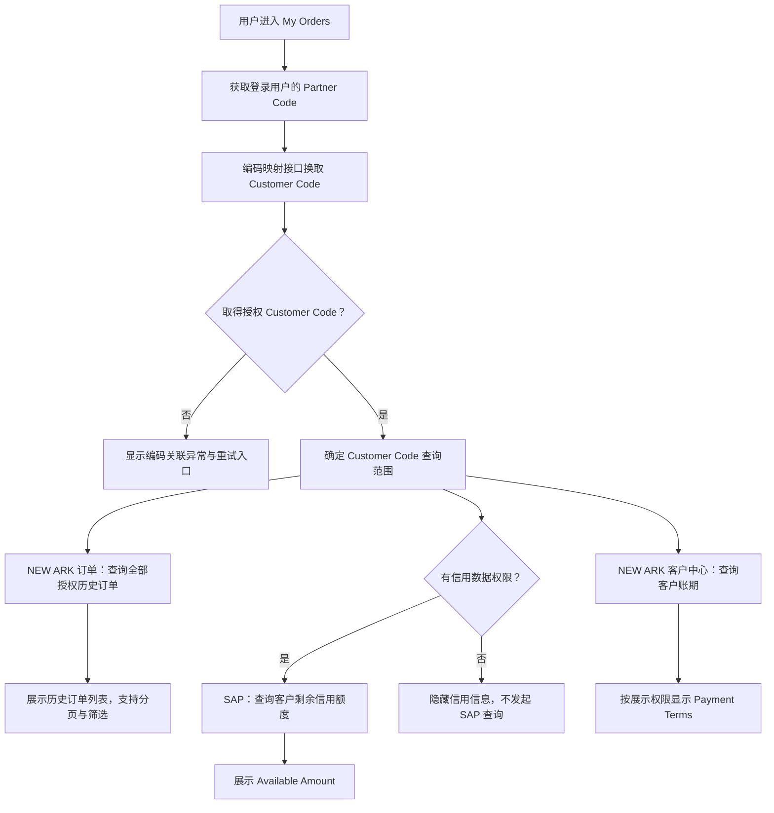
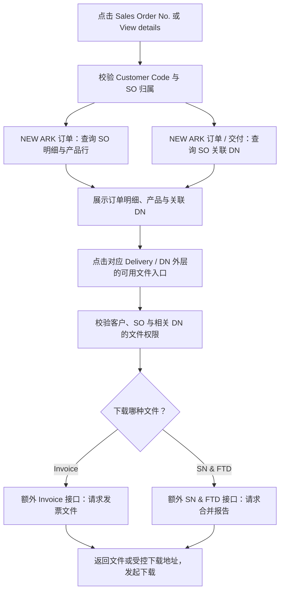
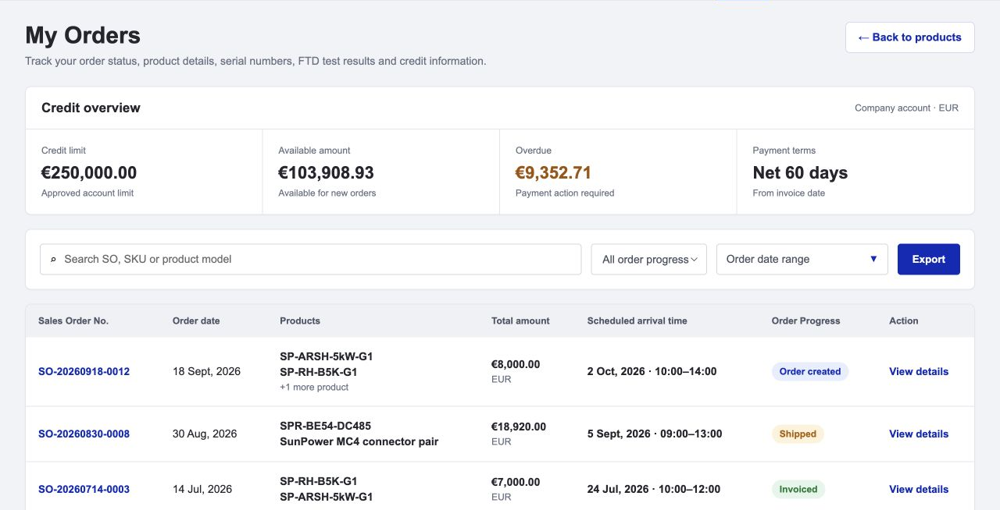
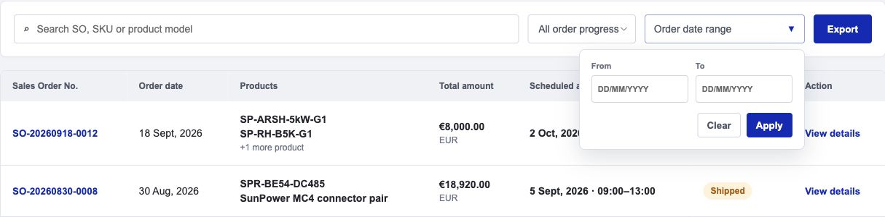
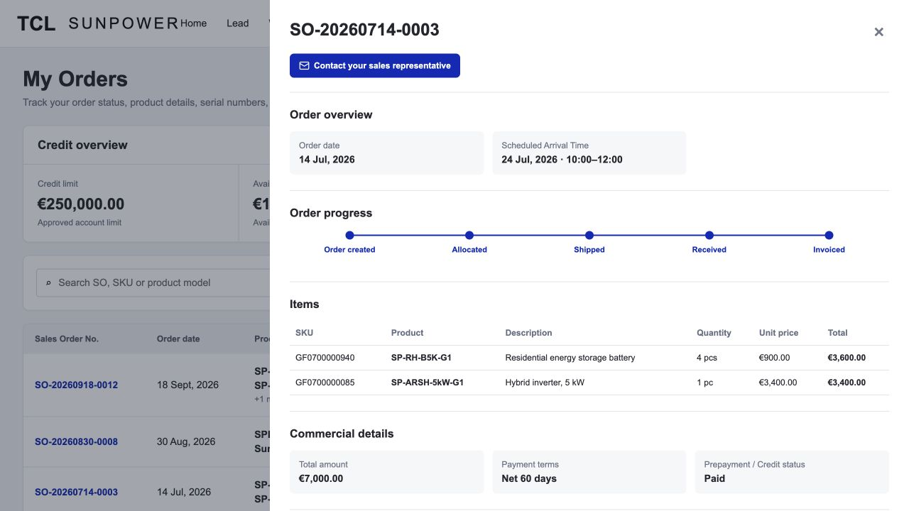
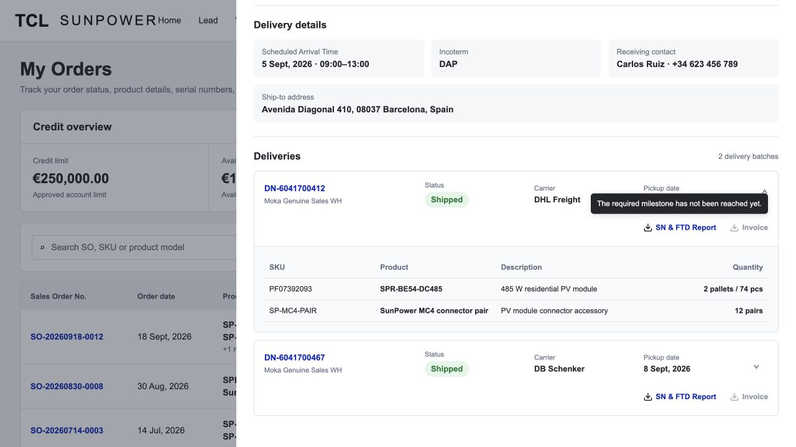
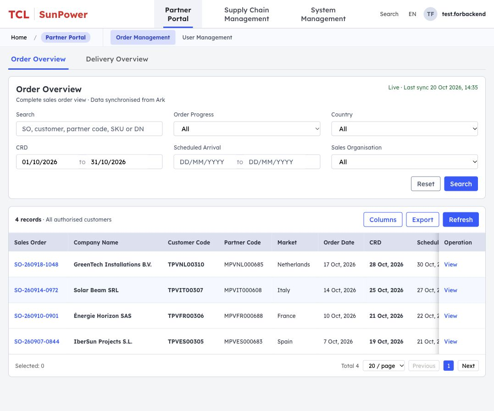
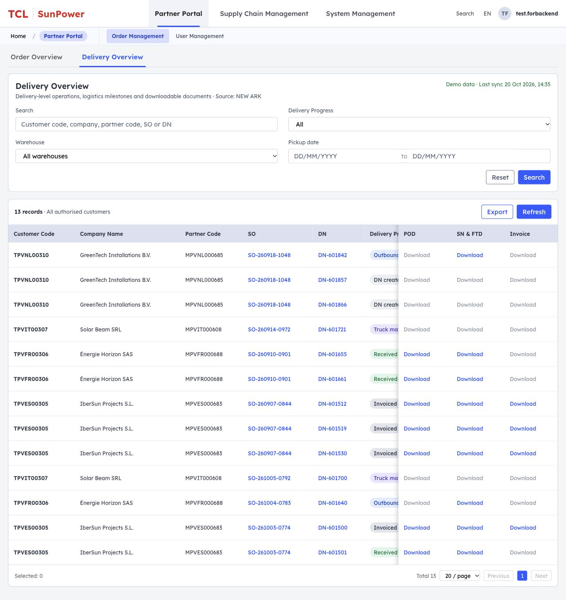
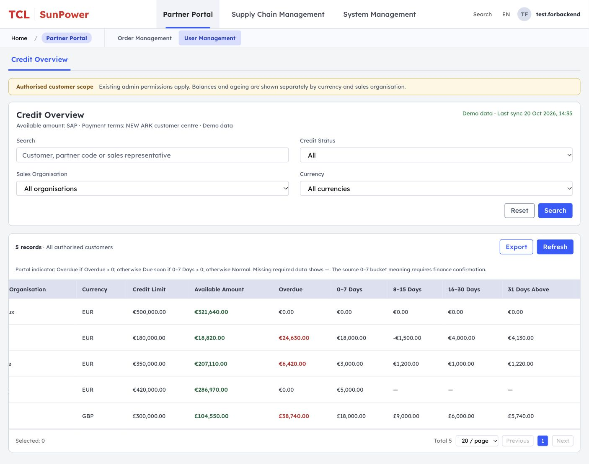

# 产品需求文档（PRD）

## 1. 文档头（元信息）

- 文档标题：SunPower Partner Portal - My Orders 与运营后台订单、交付及信用可视化
- 版本：v1.0
- 文档状态：首版需求草案，尚未交付研发
- 作者 / 日期：待填写 · 2026-10-21
- 关联系统 / 模块：SunPower Partner Portal、Partner / Customer 编码映射、新方舟（NEW ARK）订单 / 客户中心、SAP、Invoice 接口、SN & FTD 接口
- 页面路径关联：
  - 本地原型：`/partner-portal/sunpower-my-orders.html`
  - Products 原型：`/partner-portal/sunpower-products-list.html`
  - 线上原型：https://nickiisme.github.io/product-list/sunpower-my-orders.html
  - 运营后台本地源码：`/admin-order-management-prototype/`
  - 运营后台线上原型：https://nickiisme.github.io/product-list/admin-order-management/
  - GitHub 需求文档：https://github.com/Nickiisme/product-list/blob/main/docs/SunPower_My_Orders_PRD.md

本文沿用《产品需求文档（PRD）模板 v2.0》。第 7.1.1–7.1.8 节描述客户前台，第 7.1.9–7.1.15 节描述业务运营后台。订单、订单明细和 DN 来源于新方舟订单模块，客户剩余信用额度查询 SAP，账期查询新方舟客户中心，Invoice 与 SN & FTD 通过额外文件接口请求。前台的字段精简规则不直接套用于后台。

## 2. 需求概述

### 2.1 背景

SunPower 欧洲区域合作伙伴下单后，需要在 Partner Portal 中查询订单、产品、商业条款、交付批次和可下载报告。目前订单及交付数据主要存在于新方舟，客户缺少统一、直观且可自助查询的入口。

本需求按登录用户的 Partner Code 换取授权 Customer Code，再分别查询新方舟订单、SAP 剩余信用额度和新方舟客户中心账期，为客户提供历史订单查询、订单进度识别、预计到货时间查询、DN 物流信息及报告下载能力。订单明细及关联 DN 在用户点击详情时查询，Invoice 与 SN & FTD 文件通过独立接口按需请求。

业务运营还需要跨客户主体检索订单、关联 Delivery Number、核对 CRD 等业务日期、查看物流与信用信息。因此在 Partner Portal 后台增加运营查询入口，展示其权限范围内的完整业务数据；业务主数据继续在各自源系统维护。

### 2.2 目标

- 订单自助查询覆盖率：已授权客户的有效历史订单可查询率达到 100%。
- 数据一致性：Portal 展示字段与各自对应源系统数据一致率不低于 99.9%。
- 查询效率：用户可在 3 次操作内完成“找到订单并查看订单详情”。
- 信息完整性：一个订单下的多个产品和多个 DN 均可完整展示。
- 文件可用性：已生成的 SN & FTD Report、Invoice 可直接从订单详情访问。
- 运营查询完整性：授权范围内的 SO、关联 DN、客户身份和关键业务日期可从后台检索，要求每个 SO 的关联 DN 不丢失。
- 后台下载可用性：POD、SN & FTD、Invoice 三个入口在横向滚动时持续可见；文件未就绪时保持灰色禁用状态。

### 2.3 分期边界

本期做：

- 客户信用概览。
- 订单搜索、进度筛选、订单日期区间筛选。
- 订单列表及订单详情。
- 多产品、多 DN 展示。
- 订单进度可视化。
- SN & FTD Report、Invoice 下载入口。
- 联系销售代表快捷入口。
- 当前筛选结果 CSV 导出。
- 运营后台 Order Management：Order Overview、Delivery Overview。
- 运营后台现有 User Management 下新增 Credit Overview。
- 后台按客户主体、Customer Code、Partner Code、SO、DN 检索，展示 CRD、SSD、SAD 等完整运营信息。
- 后台按权限查看信用数据，下载 DN 维度的 POD、SN & FTD、Invoice。

客户前台本期不做（不约束后台字段展示）：

- 在线新增、修改或取消订单。
- 在线修改 DN 或物流信息。
- 在线修改信用额度或付款条件。
- Customer PO No. 展示或维护。
- 独立 Documents 板块。
- SOA、CMR 展示或下载。
- Pallet No.、Container No.、Pallets、Gross weight 展示。
- Delivery progress 展示。

运营后台本期不做：

- 在 Portal 修改 SO、DN、业务进度、信用额度或付款条件；仍由各自对应业务系统维护。
- 在 Portal 创建、审批、取消订单或重新生成发票。
- 从页面日期、数量或文件是否存在反向推算新方舟业务进度。
- 未确认接口和权限前开放真实客户数据；公开演示页面只使用示例数据。

## 3. 名词术语表

| 术语 | 说明 | 统一用名 |
| --- | --- | --- |
| NEW ARK | TCL / SunPower 业务系统；本需求涉及订单模块及客户中心 | 新方舟（NEW ARK） |
| SAP | 客户剩余信用额度的数据来源 | SAP |
| Available Amount | 客户当前剩余 / 可用信用额度，按 Customer Code 查询 SAP | Available Amount |
| Payment Terms | 客户账期，按 Customer Code 查询新方舟客户中心 | Payment Terms |
| SO | Sales Order，销售订单 | Sales Order / SO |
| DN | Delivery Number，一个订单可包含多个交付批次 | DN |
| CRD | Customer Requested Date，本页面不作为主要到货日期展示 | CRD |
| Scheduled Arrival Time | 预计到达客户目的地的日期及时间窗口 | Scheduled Arrival Time |
| POD | Proof of Delivery，签收或交付证明；订单签收节点的展示名称为 Received | POD |
| SN | Serial Number，产品序列号 | SN |
| FTD | 产品测试报告 | FTD Report |
| SN & FTD Report | 序列号与 FTD 测试结果的统一下载入口 | SN & FTD Report |
| Order Progress | 面向客户展示的订单业务进度 | Order Progress |
| Invoiced | NEW ARK 确认订单全部开票；部分开票展示 Invoiced · Partial，不等于全部完成 | Invoiced |
| Delivery Progress | 新方舟 DN / 交付维度的业务状态；后台独立展示，不套用订单五节点限制 | Delivery Progress |
| Customer Code | 新方舟客户主体编码；与 Company Name 分列 | Customer Code |
| Company Name | 客户公司名称，不与 Customer Code 合并成一列 | Company Name |
| Partner Code | Portal 合作伙伴与新方舟客户关系的关联编码 | Partner Code |
| SSD | 新方舟 SSD 日期字段；业务全称、源字段和取值规则待接口对接确认 | SSD |
| SAD | 本需求中 Scheduled Arrival Time 的字段缩写，来源于新方舟，不由 CRD 或 Pickup date 替代 | Scheduled Arrival Time (SAD) |
| Credit status | 客户信用状态，与 Order Progress、Delivery Progress 分开 | Credit Status |

## 4. 用户 / 角色定义

Portal 前台的 Admin / 特定 Role 信用可见性规则仅适用于客户侧 My Orders，不等同于后台运营角色。后台沿用现有管理端的菜单、功能权限和客户数据范围，不套用前台“默认仅 Admin 或授权特定 Role 可见”的限制。

| 角色 | 权限范围 | 说明 |
| --- | --- | --- |
| Partner Portal 前台客户用户 | 读取当前账号及其授权客户主体下的订单、产品、DN 和文件 | 默认不可查看前台 Credit overview；只能查看授权范围内的数据，不允许修改新方舟主数据 |
| Partner Portal 前台 Admin | 读取所属公司授权范围内全部订单、信用信息并导出 | 可查看前台 Credit overview；数据范围由客户主体、Partner Code 或账号关系决定 |
| Portal 前台信用授权特定角色 | 读取授权客户主体的信用信息 | 角色名称与权限标识待业务和权限团队确认；获授权后可查看前台 Credit overview |
| SunPower 销售代表 | 通过邮件接收客户针对订单的咨询 | 本期不在 Portal 内处理消息，仅提供邮件入口 |
| SunPower 业务运营 / 客服 | 根据后台现有菜单及功能权限，读取、查询、导出授权客户范围内的订单、DN、信用数据和文件 | 可覆盖多个客户；具体销售组织、市场或客户范围由后台权限服务决定，不受前台 Admin / 特定 Role 限制。业务主数据在对应源系统维护 |

## 5. 需求范围（功能清单 + 优先级 + 分期）

| 序号 | 系统模块 | 功能描述 | 优先级 | 期数 | 主责人 |
| --- | --- | --- | --- | --- | --- |
| 1 | Partner Portal / 顶部导航 | Products 与 My Orders 作为同级一级菜单，当前标签页切换 | P0 | 二期 | 待填写 |
| 2 | Partner Portal / Credit overview | 根据用户权限展示信用额度、可用额度、逾期金额、付款条件 | P0 | 二期 | 待填写 |
| 3 | Partner Portal / My Orders | 支持 SO、SKU、产品型号搜索 | P0 | 二期 | 待填写 |
| 4 | Partner Portal / My Orders | 支持 Order Progress 筛选 | P0 | 二期 | 待填写 |
| 5 | Partner Portal / My Orders | 支持英文日期区间筛选 | P0 | 二期 | 待填写 |
| 6 | Partner Portal / My Orders | 展示订单列表、多产品摘要和 Order Progress | P0 | 二期 | 待填写 |
| 7 | Partner Portal / Order details | 展示订单概览、状态流、产品、商业及交付信息 | P0 | 二期 | 待填写 |
| 8 | Partner Portal / Deliveries | 一个 SO 支持多个 DN，每个 DN 可展开查看 | P0 | 二期 | 待填写 |
| 9 | Partner Portal / Documents | 下载 SN & FTD Report、Invoice | P0 | 二期 | 待填写 |
| 10 | Partner Portal / Contact sales | 唤起邮件客户端联系销售代表 | P1 | 二期 | 待填写 |
| 11 | Partner Portal / Export | 导出当前筛选结果及全部产品 | P1 | 二期 | 待填写 |
| 12 | 跨系统 / 接口 | 编码映射后分别查询新方舟订单 / DN、SAP 剩余信用额度、客户中心账期及独立文件接口 | P0 | 二期 | 待填写 |
| 13 | 后台 / Order Management | 新增 Order Overview、Delivery Overview 两个页面入口 | P0 | 二期 | 待填写 |
| 14 | 后台 / Order Overview | 分列展示客户名称和编码，查询完整 SO、CRD、关联全部 DN、订单详情和订单五节点进度 | P0 | 二期 | 待填写 |
| 15 | 后台 / Delivery Overview | 按 DN 展示客户、SO、交付进度、物流信息、CRD / SSD / SAD 与三个文件入口 | P0 | 二期 | 待填写 |
| 16 | 后台 / User Management | 在现有 User Management 下增加 Credit Overview，按角色和客户范围控制可见性 | P0 | 二期 | 待填写 |
| 17 | 后台 / 操作区 | Operation 固定在右侧；Delivery 的 POD、SN & FTD、Invoice 整组固定并在外侧显示阴影 | P0 | 二期 | 待填写 |
| 18 | 后台 / 文件状态 | Download 为蓝色文字操作；未就绪时显示灰色不可点击 Download | P0 | 二期 | 待填写 |
| 19 | 后台 / 查询工具 | 组合筛选、刷新、重置与当前授权查询结果 CSV 导出 | P1 | 二期 | 待填写 |

## 6. 整体流程图

### 6.1 进入 My Orders：编码转换与首屏查询



调用顺序与边界：

1. Partner Portal 主要使用 Partner Code；下游查询前必须先换取 Customer Code。编码映射接口归属、一个 Partner Code 是否对应多个 Customer Code，待对接确认。
2. Customer Code 解析及权限校验成功后，历史订单、SAP 剩余信用额度和客户中心账期可分别发起请求、独立返回。Portal 前台信用额度查询须通过 Admin / 授权特定 Role 校验；无权限不请求、不返回信用数据。该角色限制不适用于后台运营页面。
3. “所有历史订单”指该用户映射并获授权的 Customer Code 下全部可查询历史订单，支持服务端分页；不擅自限制为最近 24 个月，也不要求一次返回全部记录。
4. SAP 或客户中心查询失败不阻断已成功取得的订单列表；对应信息展示失败 / 待获取状态并支持单独重试，不将失败值显示为零或空账期。
5. 首屏不批量拉取全部订单明细、DN 明细或文件内容；用户打开某个 SO 详情后再按需查询。

### 6.2 点击详情：订单明细、关联 DN 与文件下载



- 详情请求以授权 Customer Code 与当前 SO 为关联条件，取得订单明细及全部关联 DN；一个 SO 的多个产品 / DN 不能遗漏。SO 与 DN 是一次聚合返回还是多个接口查询，由接口契约确定。
- Payment Terms 复用本次客户中心查询结果；需要刷新时仍查询客户中心，不以订单接口或 SAP 值覆盖其来源。
- Invoice 与 SN & FTD 各走额外文件接口，点击对应入口时按需请求，不把订单明细接口当作文件下载接口。
- SN & FTD Report 和 Invoice 均归属 Delivery / DN，不归属单个产品。文件接口携带授权 Customer Code、SO、当前 DN 及必要文件标识；准确参数和服务归属待接口方确认，不预设 URL，也不通过产品 SKU 代替 DN 定位文件。
- 文件就绪状态与业务节点分别校验：当前 DN 已发货后才可下载 SN & FTD Report，当前 DN 已签收（Received）后才可下载 Invoice；同时须满足文件接口确认就绪和下载权限。不能仅凭 URL 非空或文件已生成绕过节点限制，也不能凭整单 Invoiced 自动生成下载地址。
- 客户前台仅展示 NEW ARK 明确已发货的 DN；无已发货 DN 时不展示 Delivery details、Deliveries 或预先构造的计划交付卡片。后台仍可查询完整关联 DN，不套用此前台展示限制。
- My Orders 的 Invoice 与 SN & FTD 使用各自额外文件接口；后台 POD 文件来源与具体接口单独确认，不与这两个接口混用。

### 6.3 数据来源与触发时机

| 数据 / 操作 | 数据来源 | 查询标识 | 触发时机 |
| --- | --- | --- | --- |
| Partner Code → Customer Code | 编码映射接口，归属待确认 | 登录用户授权 Partner Code | 进入 My Orders，其他业务查询之前 |
| 全部授权历史订单 | NEW ARK 订单模块 | Customer Code + 筛选 / 分页条件 | 编码转换完成后；搜索、筛选或翻页时 |
| 客户剩余信用额度 | SAP | Customer Code；其他必要维度待确认 | 编码转换完成且有信用权限后 |
| 客户账期 Payment Terms | NEW ARK 客户中心 | Customer Code | 编码转换完成后，按既定展示权限返回 |
| SO 明细与产品行 | NEW ARK 订单模块 | Customer Code + SO | 点击订单详情 |
| 关联 DN 数据 | NEW ARK 订单 / 交付接口 | Customer Code + SO；DN 明细按相关 DN 请求 | 点击订单详情；需要时展开 DN |
| Invoice | 额外 Invoice 文件接口 | Customer Code + SO + DN + 必要文件标识 | 点击对应 Delivery 的发票下载 |
| SN & FTD | 额外 SN & FTD 文件接口 | Customer Code + SO + DN + 必要文件标识 | 点击对应 Delivery 的报告下载 |

这里只确认 Available Amount 来源为 SAP、Payment Terms 来源为客户中心；Credit Limit、Overdue、Credit Status 的来源尚未单独确认，不自动沿用“全部来自新方舟”或“全部来自 SAP”的假设。

## 7. 需求详细说明（每个功能一个章节）

### 7.1 功能说明

#### 7.1.1 菜单与页面入口

- 菜单路径：Partner Portal → My Orders。
- My Orders 与 Products 为顶部同级一级菜单。
- 不展示 Products / My Orders 面包屑，避免将 My Orders 表示为 Products 的子页面。
- 从 Products 点击 My Orders 时在当前标签页打开，不新建标签。
- My Orders 页面中 My Orders 高亮，Products 不高亮。
- 页面提供 Back to products。

Portal 前台权限说明：

- 菜单权限：仅已开通 Partner Portal 订单查询权限的客户账号可见。
- 数据权限：用户只能查看当前账号及授权客户主体下的订单。
- 文件权限：下载时服务端重新校验订单归属和用户权限。
- Credit overview 权限：在 Portal 前台独立校验页面 / 功能、角色及授权客户范围；默认仅前台 Admin 用户或授权特定 Role 可见，具体 Role 名称及权限标识待确认。该限制不适用于运营后台。
- 无 Credit overview 权限时：前端隐藏整个 Credit overview 模块，后端不得返回信用额度、可用额度、逾期金额等信用数据。客户中心账期按其实际展示区域的权限独立控制，不因数据源拆分自动扩大可见范围。
- 服务端从登录用户上下文取得授权 Partner Code，经编码映射换取 Customer Code 后再请求下游；不得接受用户任意指定 Customer Code 绕过归属校验。

#### 7.1.2 页面功能明细

| 序号 | 功能模块 | 原型交互 | 需求说明 |
| --- | --- | --- | --- |
| 1 | Credit overview | 有权限时展示顶部卡片，无权限时隐藏；见图 1 | 仅 Admin 或配置的特定角色可见；Available amount 查询 SAP，Payment terms 查询 NEW ARK 客户中心；Credit limit / Overdue 来源待确认；Overdue 大于 0 时视觉强调；金额包含货币符号 |
| 2 | 搜索 | 输入后即时刷新；见图 1 | 支持 Sales Order No.、SKU、Product model 模糊搜索 |
| 3 | Order Progress 筛选 | 单选下拉框；布局见图 1 | All order progress、Order created、Allocated、Shipped、Received、Invoiced；对应阶段同时匹配该阶段的 Partial 记录，映射详见第 7.2 节 |
| 4 | Order date range | 单击紧凑按钮展开；见图 2 | 显示英文 From、To、Clear、Apply；输入格式 DD/MM/YYYY；Apply 后筛选并收起 |
| 5 | Export | 点击下载 CSV；见图 1 | 导出当前搜索和筛选条件下全部订单及每个订单的全部产品；UTF-8；文件名 sunpower-my-orders.csv |
| 6 | Order list | 点击 SO 或 View details；见图 1 | 展示 SO、日期、产品、金额、Scheduled Arrival Time、Order Progress |
| 7 | Order details | 右侧抽屉；见图 3、图 4 | 展示概览、进度、Items、Commercial；仅存在已发货 DN 时展示 Delivery details 和 Deliveries |
| 8 | Contact sales | 唤起默认邮件客户端；见图 3 | 前置邮件图标；主题及正文自动带入 SO 编号 |
| 9 | SN & FTD Report | 点击对应 Delivery 卡片外层入口；位置以第 7.1.8 节为准 | 每个 DN 一个入口，使用下载图标；当前 DN 达到 Shipped 后且文件就绪、有权限时可下载；未到节点时置灰禁用，hover / 键盘聚焦展示英文提示 |
| 10 | Invoice | 点击对应 Delivery 卡片外层入口；位置以第 7.1.8 节为准 | 每个 DN 一个入口，使用下载图标；当前 DN 达到 Received 后且文件就绪、有权限时可下载，不必等整单 Invoiced；未到节点时置灰禁用，hover / 键盘聚焦展示英文提示 |

以下截图取自客户侧 My Orders 演示原型，用于辅助说明页面布局与交互，额度、账期、订单及文件均为示例。截图不替代需求正文；数据来源与调用顺序以第 6、11 节为准，五节点及 Partial 规则以第 7.2 节为准，文件入口与 DN 产品字段以第 7.1.4、7.1.8 节为准。原型实现范围与正式需求分开说明，不以截图或演示行为作为接口能力已实现的依据。

**图 1：My Orders 列表与信用概览（功能 1、2、3、5、6）**

展示页面主体中的信用信息、搜索、Order Progress 筛选、紧凑日期入口、Export 和多产品订单列表；标题上方不展示 Products / My Orders 面包屑。



**图 2：英文日期区间展开态（功能 4）**

单击 Order date range 后展开 From / To 输入区，保留 DD/MM/YYYY 英文占位，以及 Clear / Apply 操作。



**图 3：订单详情上半区（功能 7、8）**

以已开票示例订单展示联系销售、Order overview、五节点 Order progress、Items 和 Commercial details。文件入口应位于每个 Delivery 卡片外层，不放在订单顶部。



**图 4：Delivery details、DN 展开态与禁用下载提示（功能 7、9、10）**

展示已发货订单的收货信息、多个 DN 和展开结构。DN 内不重复展示收货地址或 Ship from；产品表依次展示 SKU、Product、Description、Quantity；SN & FTD Report、Invoice 各在对应 Delivery 卡片外层展示，不随产品行重复。图中当前 DN 已发货、尚未签收，报告可用，Invoice 禁用并展示英文节点提示。字段和可见性以第 7.1.7、7.1.8 节为准。



#### 7.1.3 Order list 字段说明

| 字段 | 数据类型 / 格式 | 查询 / 展示规则 | 空值处理 |
| --- | --- | --- | --- |
| Sales Order No. | String | 可点击打开 Order details | 不允许为空 |
| Order date | D MMM, YYYY | 例如 17 Oct, 2026 | - |
| Products | Array | 展示前两个；超过两个显示 +N more product | - |
| Total amount | Currency | 包含货币符号 | - |
| Scheduled Arrival Time | D MMM, YYYY · HH:mm–HH:mm | 例如 17 Oct, 2026 · 10:00–14:00 | To be confirmed |
| Order Progress | 阶段枚举 + 完成度标记 | Order created、Allocated、Shipped、Received、Invoiced；部分完成时增加 · Partial，详见第 7.2 节 | 无法映射时展示 —，不默认归入 Order created |
| Action | Button | View details | - |

无数据时展示 No orders found。

#### 7.1.4 Order details 顶部与 Order overview

顶部：

- 标题仅展示 Sales Order No.，下方不重复展示订单状态。
- 展示 Contact your sales representative。
- 不在订单顶部展示 SN & FTD Report 或 Invoice；二者均归属于具体 Delivery / DN，在对应卡片外层各展示一个入口，详见第 7.1.8 节。
- 不展示 SOA。

Order overview 仅展示：

| 字段 | 展示规则 |
| --- | --- |
| Order date | D MMM, YYYY |
| Scheduled Arrival Time | D MMM, YYYY · HH:mm–HH:mm |

不展示 Product 汇总项和 Customer PO No.。

#### 7.1.5 Items

| 字段 | 说明 |
| --- | --- |
| SKU | 产品 SKU |
| Product | 产品型号 |
| Description | 产品描述 |
| Quantity | 数量及单位 |
| Unit price | 单价或计价方式 |
| Total | 产品行总金额 |

- 一个订单可包含多个产品。
- 默认最多展示 5 条。
- 超过 5 条时展示 Show N more items。
- 展开后按钮变为 Show fewer items。

#### 7.1.6 Commercial details

| 字段 | 说明 |
| --- | --- |
| Total amount | 订单总金额，包含货币符号 |
| Payment terms | 客户账期，按 Customer Code 查询 NEW ARK 客户中心；复用首屏结果或按需刷新 |
| Prepayment / Credit status | 预付款或信用审批状态 |

不单独展示 Currency。

#### 7.1.7 Delivery details

展示前提：NEW ARK 返回当前订单至少一条已发货 DN。订单仅处于 Order created、Allocated 等未发货状态且无已发货 DN 时，不展示本区和 Deliveries 区，不显示计划 DN、仓库、提货日期或“0 delivery batches”。Order overview 中的 Scheduled Arrival Time 不受此区隐藏影响。

| 字段 | 说明 |
| --- | --- |
| Scheduled Arrival Time | 预计到达客户目的地的日期及时间窗口 |
| Incoterm | 贸易条款 |
| Receiving contact | 收货联系人及联系方式 |
| Ship-to address | 收货地址 |

#### 7.1.8 Deliveries / DN

一个订单可关联零条或多条 DN。客户前台仅对已发货的 DN 使用可展开卡片展示；部分发货时展示已发货批次，尚未发货的批次暂不展示。发货事实取自 NEW ARK 的 DN 节点元数据，不根据日期、文件是否生成或整单进度推算，不自行生成 DN。后台 Order / Delivery Overview 仍保留全部授权关联 DN。

DN 卡片摘要：

| 字段 | 说明 |
| --- | --- |
| DN No. | Delivery Number 编号 |
| Warehouse | 发货仓 |
| Status | DN 当前状态 |
| Carrier | 承运商；未分配时显示 Pending assignment |
| Pickup date | 提货日期 |
| SN & FTD Report | 当前 Delivery / DN 的合并报告下载入口；一个 DN 仅展示一个 |
| Invoice | 当前 Delivery / DN 的发票下载入口；一个 DN 仅展示一个 |

两个文件入口放在 Delivery 卡片外层的独立操作区，不嵌套在卡片展开按钮中；卡片收起时仍可见，点击文件不切换卡片展开状态。继续使用下载图标和英文名称。

DN 展开后仅展示本次 Delivery 的产品明细表，不重复展示 Ship from。Warehouse 仍保留在卡片摘要中。

| 顺序 | 产品字段 | 展示规则 |
| --- | --- | --- |
| 1 | SKU | 新方舟 DN 产品行的 SKU 编码，保留完整值及前导零；缺失显示 — |
| 2 | Product | 该产品的型号 / 名称；与 SKU 分列，缺失显示 — |
| 3 | Description | 新方舟 DN 产品行的 Material description；不以型号 / SKU 替代物料描述，缺失显示 — |
| 4 | Quantity | 该 DN 下该物料的实际交付数量及单位；不直接重复整单订购数量；同一物料分多 DN 时分别展示各批次数量，缺失显示 — |

文件归属与可用规则：

- SN & FTD Report 针对整个 Delivery / DN，覆盖该批次产品，不在每条产品行重复展示；Invoice 同样按 Delivery / DN 提供。
- 每个 Delivery 固定保留一个 SN & FTD Report 和一个 Invoice 入口；如底层返回多个文件，由同一入口进入受控文件清单或下载包，具体返回形式由文件接口确认。
- 两种文件均须同时满足“对应 DN 业务节点已达到 + 文件接口确认就绪 + 有下载权限”才可点击。SN & FTD Report 的最低节点为 Shipped；Invoice 的最低节点为 Received。源节点和文件可用性是独立字段，不以文件存在反推节点。
- 节点按各 DN 独立判断，不使用整单进度统一放行所有 DN。部分发货订单中已发货 DN 的报告可下载；某 DN 已签收且发票就绪时，其 Invoice 可下载，不必等整单 Invoiced；未签收 DN 即使发票文件已经生成也不可下载。
- 下载请求绑定当前 Customer Code、SO 与 DN，服务端重新校验归属；不能复用其他 DN 的文件结果，也不按产品行数量复制入口。
- 正式文件接口在服务端重新校验节点、就绪状态与权限；前端禁用样式不能作为安全控制。演示原型使用示例节点和文件元数据，文件服务尚未接通时不得宣称真实文件已下载。

禁用入口交互：

| 禁用原因 | 英文 hover / 聚焦提示 | 行为 |
| --- | --- | --- |
| 尚未达到对应业务节点 | The required milestone has not been reached yet. | 置灰禁用，不发起下载 |
| 已达节点，但文件尚未就绪 | The file is not available yet. Please try again later. | 置灰禁用，不误报节点未达到 |
| 已达节点，但无下载权限 | You do not have permission to download this file. | 置灰禁用，服务端同样拒绝请求 |

禁用按钮的外层承载 tooltip，使鼠标 hover 和键盘聚焦均可显示原因，且不影响 Delivery 卡片的展开 / 收起。

DN 展开内容不展示：Ship from、重复的 Ship-to address（保留在订单级 Delivery details）、产品行下载列、DN quantity 汇总字段、Delivery progress、Pallet No.、Container No.、Pallets、Gross weight、CMR、独立 Serial numbers、独立 FTD test。这里删除的是独立 DN quantity 汇总字段，不影响产品表的 Quantity。

#### 7.1.9 后台菜单与权限

菜单层级：

```text
Partner Portal
├── Order Management（新增）
│   ├── Order Overview
│   └── Delivery Overview
└── User Management（已有）
    └── Credit Overview（新增）
```

- 后台面向 SunPower 内部业务运营，不面向安装商；不放在客户 Products / My Orders 菜单下。
- Order Management 和 User Management 均属于现有 Partner Portal 顶部菜单；Credit Overview 不放在 Order Management 下。
- “所有客户数据”指当前运营账号获授权的全部客户主体；普通运营账号不得因拥有菜单权限而自动获得全组织数据。
- 后台 Credit Overview 沿用现有管理端的菜单 / 功能授权及客户数据范围，由获授权的业务运营账号访问；不额外套用 Portal 前台“默认仅 Admin 或授权特定 Role 可见”的规则。
- 后台订单列表中的 Credit 字段、详情中的信用数据按后台对应功能权限和客户范围返回，不依据客户前台账号是否具有 Admin / 特定 Role 判断；未获后台授权时不返回相关数据。
- 每次订单查询、DN 查询、导出和下载均在服务端重新校验范围。前台客户权限与后台运营权限分别配置。

后台流程：运营登录并校验权限 → 选择 Order / Delivery / Credit Overview → 按授权客户范围和对应来源查询数据 → 查看 SO 与关联 DN、核对日期或信用 → 经额外文件接口下载或导出结果。订单与 DN 查询新方舟订单模块，剩余信用额度查询 SAP，账期查询新方舟客户中心；主数据维护在对应业务系统处理。

#### 7.1.10 后台 Order Overview

**列表字段**

| 字段 | 需求说明 |
| --- | --- |
| Sales Order | SO 编号，点击查看订单详情 |
| Company Name | 客户公司名称，独立列 |
| Customer Code | 新方舟客户编码，独立列 |
| Partner Code | 合作伙伴编码 |
| Market | 所属国家 / 市场 |
| Order Date | 订单日期，示例 17 Oct, 2026 |
| CRD | 客户期望日期；后台保留，不能被 SAD 替代 |
| Scheduled Arrival | 计划到达日期，对应新方舟 SAD |
| Order Progress | 仅展示 Order created、Allocated、Shipped、Received、Invoiced 五个指定节点；部分完成增加 · Partial 标记 |
| Product | 展示产品型号与规格，多产品可使用摘要，详情必须保留全部产品关系 |
| Ordered / Allocated / Shipped | 分别展示订购、分配和已发货数量及单位；缺值显示“—”，不得将缺值视为零 |
| Delivery Number | 展示关联 DN；超过一条可使用首条 +N，点击查看全部 DN |
| Total Amount | 订单总金额，保留币种符号 |
| Credit | 订单相关信用状态；受信用权限控制，与订单进度区分 |
| Sales Rep. | 负责的销售代表 |
| Updated | 新方舟业务数据最后更新时间，不等同于 Portal 同步时间 |
| Operation | View 蓝色文字操作，打开订单详情；整列固定在表格右侧 |

**筛选与交互**

| 功能模块 | 原型交互 | 需求说明 |
| --- | --- | --- |
| Search | 输入关键字 | 支持 SO、Company Name、Customer Code、Partner Code、SKU / 产品型号、关联 DN；原型使用模糊匹配，正式接口按约定规则查询 |
| Order Progress | 单选下拉 | All + 五个指定订单节点；不得使用 Delivery Progress 替代 |
| Country | 单选下拉 | 按国家 / 市场筛选 |
| CRD | 日期区间 | From / To，英文 DD/MM/YYYY；包含起止日 |
| Scheduled Arrival | 日期区间 | 按 SAD 筛选，与 CRD 独立 |
| Sales Organisation | 下拉筛选 | 只列出账号有权限的销售组织 |
| Search / Reset | 应用 / 清空条件 | Search 应用组合条件；Reset 清空后台所有筛选，包括日期区间 |
| Export | 导出 CSV | 导出当前条件下全部授权结果；见第 7.1.15 节 |
| Refresh | 保留条件刷新 | 重新请求当前筛选结果，同步时间以成功响应更新 |

- 一个 SO 可对应多个 DN。点击首条 DN 或 +N 时，完整显示关联 Delivery Number 列表，不能只返回第一条。
- 从关联 DN 查看详情时，带入当前 SO 与 DN 上下文，并定位 / 高亮目标 DN。
- SO / View 打开只读详情，保留原列表筛选与滚动位置；关闭后回到原列表。
- 当前详情原型展示订单进度、客户、总金额、Order Date / CRD / Scheduled Arrival / 更新时间及全部 DN 摘要；正式业务明细以新方舟接口及最终字段映射为准。
- “完整运营信息”不等同于无限制披露信用或个人信息；所有字段仍遵守对应权限。



#### 7.1.11 后台 Delivery Overview

数据粒度：每条 DN 一行。同一 SO 的多个 DN 应分行展示，不能按 SO 合并丢失交付信息。

| 顺序 | 字段 | 需求说明 |
| --- | --- | --- |
| 1 | Customer Code | 所属客户编码，与名称分列 |
| 2 | Company Name | 客户公司名称 |
| 3 | Partner Code | 合作伙伴编码 |
| 4 | SO | 关联 Sales Order |
| 5 | DN | Delivery Number，作为交付关联标识 |
| 6 | Delivery Progress | 新方舟交付源状态；独立于订单五节点 |
| 7 | Warehouse | 发货仓库 |
| 8 | Carrier | 承运商，未分配时展示 Pending assignment |
| 9 | Pickup Date | 提货日期 |
| 10 | CRD | 客户期望日期；明确来自 SO 还是 DN 维度，以新方舟映射为准 |
| 11 | SSD | 新方舟 SSD 日期字段；业务全称及取值口径待确认 |
| 12 | Scheduled Arrival Time (SAD) | 计划到达日期；不得从 CRD / Pickup Date 推算 |
| 13 | POD | 签收凭证 Download，固定在右侧操作区 |
| 14 | SN & FTD | 合并报告 Download，固定在右侧操作区 |
| 15 | Invoice | 发票 Download，固定在右侧操作区；使用 Invoice 文案 |

- Search 支持 Customer Code、Company Name、Partner Code、SO、DN、Warehouse、Carrier；可与 Delivery Progress、Warehouse、Pickup date 区间组合筛选。
- SO 用于查看关联订单，DN 用于定位对应交付；不得丢失当前查询上下文。
- Pickup Date、CRD、SSD、SAD 均使用英文欧洲日期格式 `D MMM, YYYY`，示例 `17 Oct, 2026`；没有时间字段时不补造时间。
- Order Overview 的 DN 关联与本列表必须使用同一稳定 DN 标识，避免同号跨组织关联错误。
- 后台展示独立 Delivery Progress 列；客户前台不展示 Delivery Progress 模块的约束不适用于此页。



#### 7.1.12 后台 Credit Overview

- 菜单路径：Partner Portal → User Management → Credit Overview。
- 面向获后台菜单 / 功能授权的业务运营账号，按后台既有数据范围查询；不以 Portal 前台 Admin / 特定 Role 作为访问条件。
- 数据按客户主体展示，而非按 Portal 登录用户重复展示；同一客户有多个币种 / 销售组织时必须明确区分，不得直接相加。

| 字段 | 需求说明 |
| --- | --- |
| Customer Code | 新方舟客户主体编码 |
| Company Name | 客户公司名称，独立于编码 |
| Partner Code | 合作伙伴编码 |
| Credit Limit | 信用总额度，包含币种；数据来源尚待单独确认 |
| Available Amount | 当前剩余 / 可用额度，按 Customer Code 查询 SAP，保持 SAP 源值，不由前端用额度减订单金额推算 |
| Overdue | 逾期金额，数据来源待确认；按实际金额是否大于零作提示，不能按字符串包含某个字符判断 |
| Payment Terms | 客户账期，按 Customer Code 查询 NEW ARK 客户中心 |
| Credit Status | 客户信用状态；原型示例为 Normal、On hold、Review、Blocked，来源、最终枚举与映射待确认 |
| Operation | 当前原型保留 View history 文字入口；信用历史接口、范围和可用性另行确认，本期不得把未接通入口视为已具备真实历史查询能力 |

- 支持 Customer Code、Company Name、Partner Code 搜索，支持 Credit Status、Sales Organisation 筛选和当前结果导出。
- Credit Status 不与订单信用状态、订单进度或交付进度共用枚举。
- 未获后台对应菜单 / 功能授权时：隐藏相关入口，接口拒绝请求；查询和导出均校验后台授权客户范围。Portal 前台信用角色规则不参与后台判定。
- 缺失金额显示“—”而非零；不同币种分开展示和导出。



#### 7.1.13 后台固定操作区与样式

- Company Name 与 Customer Code 在三个列表中始终分列。
- 宽表格允许横向滚动，以保留完整运营字段。
- Order Overview 的 Operation 列始终固定在右侧；Credit Overview 保留操作列时同样固定。
- Delivery Overview 的 POD、SN & FTD、Invoice 三列共同固定在右侧，按上述顺序排列；表头与数据行对齐，横向滚动时互不遮挡。
- 固定操作区左边缘显示连续、柔和的阴影；Delivery 的阴影放在 POD 左侧，三列内部不重复显示阴影。
- Download 与 View 采用一致的蓝色文字操作，无按钮边框、填充背景或新增下载图标。
- 筛选框边框为浅灰色，聚焦时使用蓝色提示；固定列阴影不得改变筛选框样式。
- 后台沿用已提供的 Admin UI 规范：Lexend Deca 字体、主色 `#3562ff`、32 px 筛选及工具栏控件、24 px 行内及分页控件、4 px 控件圆角、8 px 面板圆角。

#### 7.1.14 后台文件可用性

| 文件状态 | 展示 | 点击行为 |
| --- | --- | --- |
| 已生成且当前用户有下载权限 | 蓝色 Download 文字 | 校验 SO / DN 归属和文件权限后下载 |
| 未生成、未就绪或缺失 | 灰色 Download 文字 | 禁用，不发送下载请求；不再展示 Not ready |
| 无相应文件权限 | 按权限隐藏入口或拒绝访问 | 服务端不得返回文件地址 |
| 已就绪但下载失败 / 地址过期 | 保留可重试提示 | 重新获取受控地址或提示失败，不以成功提示代替真实下载 |

- 三种文件分别判断可用状态，不能只根据订单为 Invoiced 就认定所有文件可下载。
- SN 与 FTD 使用同一 SN & FTD 入口，不拆成两个下载操作。
- 一个 DN 存在多个文件时，通过文件清单或压缩包返回完整文件集合；接口方式待新方舟和文件团队确认。
- CMR 不在当前后台原型文件区展示；不新增独立 Documents 板块。

#### 7.1.15 后台导出、同步与数据关系

- Export 导出当前搜索和筛选条件匹配的全部授权结果，不仅限当前分页；仅表格实际显示一个分页时也不得漏掉剩余数据。
- CSV 使用 UTF-8，保留完整 Customer Code / Partner Code / SO / DN，避免编码截断或前导零丢失；字符串按 CSV 规则转义。
- Order 导出需保留全部产品与关联 DN，字段可采用明细行或明确分隔的数组；正式方案在接口对接中确认。
- Delivery 导出以 DN 为粒度，包含三个文件的可用状态，不导出永久文件地址或签名凭证。
- Credit 导出校验后台既有导出权限和客户范围，保留币种和销售组织维度；不套用 Portal 前台 Admin / 特定 Role 规则，导出权限不能只由菜单是否显示决定。
- CSV 中可能被表格软件识别为公式的文本需要按导出安全策略处理；业务数字仍按数值输出。
- 页面展示同步成功时间；查询失败不得更新为成功时间，保留重试入口。
- SO → 产品为一对多，SO → DN 为一对多，DN → 产品为一对多。客户通过稳定 Customer ID / Customer Code 与 Partner Code 映射；同一登录用户可能关联多个客户主体，不能直接把“用户”当作“客户”。

### 7.2 状态流转

Order Progress 与 Delivery Progress 均以新方舟返回的数据为唯一来源，前端不得根据日期、DN 数量或其他页面字段自行推算状态。

- Order Progress：客户前台及后台 Order Overview 均只提取并映射下述五个指定节点。新方舟中的其他中间状态不增加新的订单进度节点。
- Delivery Progress：保留新方舟交付维度的源状态，用于 DN / 交付数据判断；客户前台不单独展示进度条或模块，后台 Delivery Overview 独立展示该列，不限制为订单五节点。

#### 7.2.1 五节点与源字段职责

固定节点顺序：`Order created → Allocated → Shipped → Received → Invoiced`。列表、详情进度条、筛选和导出中的订单进度名称保持一致；Delivery Progress 与 POD 文件名称不因此改名。

| NEW ARK 字段 | 在 Portal 中的用途 | 约束 |
| --- | --- | --- |
| Order status | SO 订单级业务进度映射依据 | 确认其订单汇总口径；部分完成不能当作全部完成 |
| Status | 产品行 / 明细状态的补充依据 | 与 Order status 的粒度区别须由接口方确认，不能直接以某一行代替整单 |
| Allocation Status | 区分尚未分配、部分分配和全部分配 | 与订单业务状态共同判断；不把全部 Created 订单都当作已分配 |
| Approve Status | 独立审批状态 | Approving / Approved 不作为五节点，不直接推进订单进度 |
| System Status | 独立系统处理 / 同步状态 | Pending Push、SAP Sync Failed、SAP Sync Success、SAP Received Success 不作为五节点，不覆盖业务进度 |

接口应同时提供可追溯的源状态和映射结果；精确字段标识、枚举编码及整单汇总口径由 NEW ARK 接口方确认。以下为 Portal 的目标展示规则，不代表所有源字段语义已完成确认。

#### 7.2.2 NEW ARK → Portal 映射表

| NEW ARK 情况 | Portal 列表展示 | 详情进度条 |
| --- | --- | --- |
| Created，尚未分配 | Order created | 创建节点完成 |
| Partially Allocated，或部分备货／安排运输 | Allocated · Partial | 分配节点部分完成 |
| Allocated，处于 Prepare Truck / Truck TBC | Allocated | 分配完成，等待出库 |
| Partially Shipped | Shipped · Partial | 出库节点部分完成 |
| Shipped | Shipped | 出库完成 |
| Customer Signed\* | Received | 签收完成 |
| Partially Invoiced | Invoiced · Partial | 开票节点部分完成 |
| Invoiced | Invoiced | 开票完成 |

\* `Customer Signed` 只有在 NEW ARK 确认其含义为“客户已收货 / 签收（POD）”后，才可映射为 Received。若其表示合同或订单签署，不可使用该映射，须另取有效的签收业务字段。该语义及判定字段待确认；页面节点只显示 Received，不附加 (POD)。

`Partially Prepare Truck`、`Partially Truck TBC` 按“部分备货／安排运输”的情形核对；具体源枚举需纳入接口映射清单。单独出现 Prepare Truck / Truck TBC 时，仍须核对 Allocation Status，不能仅凭运输准备文案判为全部分配。

#### 7.2.3 Partial、整单汇总与展示规则

- Partial 是完成度标记，不增加第六个节点；列表采用“阶段 · Partial”，详情在对应节点显示部分完成样式及文字，不使用全部完成勾选。
- 详情节点分别支持未开始、部分完成、已完成。后续阶段出现部分完成，不代表前序节点已经全部完成；各节点完成度以经确认的源业务数据为准，不因当前阶段较靠后而自动全部点亮。
- 一个 SO 可以有多个产品行和多个 DN。整单进度由服务端依据 NEW ARK 的订单汇总状态及经业务确认的明细规则统一映射，前端不取“进度最靠后的一个 DN / 产品行”作为整单状态，不自行按 DN 个数或产品行数计算完成比例。
- 部分与全部的数量口径、取消 / 退货等排除规则、源字段冲突时的优先级，需与 NEW ARK 确认后形成可测试的接口规则；未确认时不得自行补造完成度。
- Partially Invoiced 不能直接映射为全部 Invoiced，也不能把整条进度条标为全部完成。文件是否可下载以额外文件接口的权限及可用性为准，不能反向用文件存在与否推进订单节点。
- 前后台 Order Overview 使用同一套订单映射；筛选某阶段时，包含该阶段的完整及 Partial 记录。源 Shipped 映射为 Shipped，Partially Shipped 映射为 Shipped · Partial；Processing、Completed 不作为 Portal 的列表进度文案。
- Approve Status 和 System Status 与业务进度独立。例如 Invoiced + SAP Sync Failed 不回退为 Order created；Created + Approving 也不能直接显示 Allocated。后台可分别保留审批和同步信息用于排查，不混入订单五节点。
- 空值、未识别源枚举或无法确认的组合不默认判为 Order created / Invoiced；Portal 显示“—”，后台保留源值并记录待核对原因。
- Delivery Progress 保留 DN 维度源状态，不由 Order Progress 反向生成，也不因五节点映射而删减其中间状态。后台不提供手动推进状态按钮。

### 7.3 异常 / 边界场景

| 场景 | 处理规则 |
| --- | --- |
| 无订单 / 无筛选结果 | 展示 No orders found，并保留筛选条件 |
| From 晚于 To | 阻止 Apply，提示 From date must be earlier than To date. |
| 日期格式错误 | 阻止 Apply，提示 Use DD/MM/YYYY. |
| Scheduled Arrival Time 为空 | 展示 To be confirmed |
| Carrier 未分配 | 展示 Pending assignment |
| SN 或 FTD 未就绪 | 报告按钮禁用 |
| 报告 / 发票尚未到下载节点 | 当前 DN 未到 Shipped 时报告不可下载，未到 Received 时 Invoice 不可下载；禁用入口 hover / 聚焦提示 The required milestone has not been reached yet. |
| Invoice 未生成 | 保留对应 Delivery 的 Invoice 入口并置灰禁用，不影响其他 DN 的可用文件 |
| 接口失败 | 展示失败提示和 Retry，不将旧缓存冒充最新数据；SAP / 客户中心失败不阻断已成功返回的订单列表 |
| 权限不足 | 不返回数据，不泄露订单是否存在 |
| 重复点击下载 | 请求幂等，不产生重复业务记录 |
| 一个 SO 多个 DN | 全部返回并逐条展示 |
| 一个 DN 多个产品 | 返回完整产品关系，产品表按 SKU、Product、Description、Quantity 四列展示；数量为该 DN 的实际交付数量；SN & FTD Report / Invoice 各按 DN 展示一个入口，不按产品重复 |
| 仅创建 / 分配，尚无已发货 DN | 客户前台不展示 Delivery details、Deliveries 或计划交付卡片；后台仍按权限返回真实关联 DN |
| 后台一个 SO 多个 DN | 列表可收起摘要，但点击后必须可查看全部关联 DN |
| 后台文件未就绪 | 对应列显示置灰、不可点击的 Download，不展示 Not ready |
| 后台表格横向滚动 | 固定右侧 Operation；Delivery 的三个下载列作为整体固定，只有左边界有阴影 |
| 后台未获对应菜单 / 功能或客户范围授权 | 按后台既有权限规则隐藏或拒绝相关查询、导出；不以 Portal 前台 Admin / 特定 Role 作为后台授权条件 |
| 后台 SSD / SAD 字段缺失 | 显示“—”或明确待确认，不以 CRD 或提货日期静默替代 |
| 后台不同币种 / 销售组织 | 分开展示，不跨币种汇总可用额度或逾期金额 |
| Partner Code 无 Customer Code 映射 | 提示客户关联异常；阻止依赖 Customer Code 的查询，不把 Partner Code 当 Customer Code 使用 |
| 一个 Partner Code 对应多个 Customer Code | 按已授权映射范围和明确规则查询；规则确认前不得静默只取第一条或扩大到未授权客户 |
| SAP 剩余信用额度查询失败 | 对应信息提示失败并单独重试，不显示为 0，不影响订单列表 |
| 客户中心账期查询失败 | 对应区域提示失败并单独重试，不使用其他系统值替代 |
| 详情或 DN 查询失败 | 标明失败区域，支持重试；不能把查询失败显示成“该订单没有 DN” |
| Invoice / SN & FTD 额外接口失败 | 提示对应文件请求失败并允许重试，不修改订单进度或其他文件状态 |
| 部分分配 / 部分出库 / 部分开票 | 列表显示对应阶段 · Partial，详情对应节点显示部分完成；不得把整单标为全部完成 |
| 源状态空值、未识别或语义未确认 | 显示 —；后台保留源值及核对原因，不默认归为 Order created，也不把 Customer Signed 未确认语义当成 POD |
| 审批中或 SAP 同步失败 | 与业务进度独立处理，不自动推进或回退 Order Progress |

## 8. 非功能需求

### 8.1 性能

- 首屏列表和订单详情接口 P95 响应时间不超过 2 秒。
- 默认支持至少 1,000 条订单的服务端分页或游标加载。
- CSV 数据量超过约定阈值时切换为后端异步生成。
- 后台跨客户列表使用服务端分页、筛选与排序；不能先把全部客户数据下载到浏览器再依赖前端过滤实现权限。

### 8.2 安全

- 编码映射、订单、SAP、客户中心和文件接口均按登录用户、授权 Partner Code / Customer Code 及订单归属校验权限。
- 下载地址使用短时有效或一次性签名。
- 联系人信息按最小必要原则展示。
- 导出数据不得超出当前账号权限。
- 后台查询、导出和文件下载保留操作者、客户范围、SO / DN、操作时间及结果的审计记录；不记录签名地址或完整个人信息。

### 8.3 兼容性与扩展性

- 支持 Chrome、Edge、Safari 最近两个主版本。
- 桌面端优先，窄屏下工具栏、表格和抽屉仍可操作。
- 页面语言统一为英文，日期输入不得出现中文“年/月/日”。
- 状态映射配置化，避免前端硬编码新方舟状态。
- SO、DN、Product 使用稳定唯一 ID 关联。

## 9. 埋点 / 数据需求

| 事件名 | 触发时机 | 建议属性 | 统计目的 |
| --- | --- | --- | --- |
| my_orders_view | 页面成功打开 | customer_id、order_count | 订单页使用量 |
| my_orders_search | 用户搜索 | keyword_type、result_count | 常用查询方式 |
| my_orders_filter | 应用进度或日期筛选 | progress、from_date、to_date、result_count | 筛选使用情况 |
| my_orders_export | 点击 Export | result_count、filter_applied | 导出需求 |
| order_detail_view | 打开详情 | so_id、order_progress、dn_count、item_count | 详情访问 |
| dn_expand | 展开 DN | so_id、dn_id、dn_status | 交付信息关注度 |
| document_download | 点击文件 | so_id、dn_id、document_type、available | 文件使用和失败情况 |
| contact_sales_click | 点击联系销售 | so_id | 人工协助需求 |
| admin_overview_view | 进入后台 Order / Delivery / Credit 页 | module、role_scope | 运营模块使用量 |
| admin_overview_search | 应用后台筛选 | module、filter_type、result_count | 检索效率 |
| admin_related_dn_view | 查看 SO 关联 DN | so_id、dn_count | 订单交付追踪 |
| admin_export | 发起后台导出 | module、result_count、result | 导出使用和失败监控 |
| admin_document_download | 后台点击可用文件 | so_id、dn_id、document_type、result | 文档使用及失败率；置灰项不触发下载事件 |

埋点使用内部 ID 或脱敏值，不采集联系人电话、地址等敏感信息。

## 10. 历史数据处理

- 用户进入 My Orders 后查询当前用户映射且获授权 Customer Code 下的全部可查询历史订单，采用服务端分页；不默认截断为最近 24 个月。NEW ARK 若有归档、迁移或历史查询限制，需明确返回边界，不能将受限结果标为完整历史。
- 历史业务状态按第 7.2 节映射。若出现旧版 Completed 值，须确认其确实代表全部开票后才映射为 Invoiced，不仅凭“已完成”文案自动点亮全部节点。
- 历史 Scheduled Arrival Time 缺失时展示 To be confirmed，不使用 CRD 或 Pickup date 静默替代。
- 历史 DN 缺少 Carrier、POD 或文件关系时按空值规则处理，并纳入数据质量检查。
- 后台历史客户、SO 与 DN 的关联应按稳定标识回填；缺失的 SSD、SAD、信用状态和文档按空值 / 灰色 Download 规则处理，不人为补造。

## 11. 跨系统对接说明

### 11.1 系统分工

数据来源和触发时机以第 6.3 节为准，具体接口路径、归属系统及请求字段命名由各接口方确认。

- Partner Portal 前台身份权限服务：提供当前客户用户的 Partner Code、授权客户范围、前台 Admin / 特定 Role 与信用可见权限。
- 后台身份权限服务：提供内部运营账号既有菜单、功能 / 导出权限和客户数据范围；不复用前台信用角色限制。
- 编码映射接口：根据 Partner Code 返回 Customer Code；接口归属、有效性及一对多映射规则待确认。该步骤是下游客户维度查询的前置依赖。
- NEW ARK 订单模块：提供全部授权历史 SO、订单日期、金额、原始状态、业务日期、订单产品行及关联 DN；详情需包含完整 SO → 产品、SO → DN、DN → 产品关系。
- SAP：按 Customer Code 返回客户剩余信用额度 Available Amount，并明确币种、必要业务维度及数据时间；不由 Portal 自行计算。
- NEW ARK 客户中心：按 Customer Code 返回客户账期 Payment Terms。
- 额外 Invoice 接口：按 Delivery / DN 归属及权限提供发票文件 / 文件集合或受控下载地址。
- 额外 SN & FTD 接口：按 Delivery / DN 提供该批次序列号与测试报告的统一文件 / 文件集合或受控下载地址，不按单个产品提供页面入口。
- 邮件客户端：承接“联系销售代表”的邮件入口。

Credit Limit、Overdue、Credit Status 与后台 POD 文件来源仍待分别确认，不能因为 Available Amount 已确定查询 SAP，就推定这些字段也来自 SAP。

### 11.2 请求顺序与接口契约

1. 从登录上下文取得授权 Partner Code，先调用编码映射；映射成功后才使用 Customer Code 查询订单、SAP 和客户中心。
2. Portal 前台首屏的历史订单、剩余信用额度、账期分别请求、独立处理成功 / 失败；其中信用请求须先通过前台 Admin / 授权特定 Role 及客户范围校验。后台信用请求则使用既有后台菜单 / 功能权限与数据范围，不套用前台角色条件。不得将 SAP 或客户中心的成功作为展示订单列表的硬性前提。
3. 历史订单查询覆盖全部授权可查询历史数据，支持搜索、状态、日期区间、分页和排序；翻页或筛选继续沿用同一授权客户范围。
4. 点击 SO 详情时，使用 Customer Code + SO 查询订单明细与关联 DN。一个 SO 的多条产品行、多个 DN 及每个 DN 下产品关系均需完整返回；不将导出明细行直接当作独立订单。
5. SO / DN 查询只提供业务数据。Invoice、SN & FTD 通过各自额外接口按需请求，不能假设订单明细响应内已经包含文件本体或永久下载地址。
6. SN & FTD Report、Invoice 均按 Delivery / DN 请求；服务端重新校验 Customer Code、SO 与当前 DN 的归属，不能以产品 SKU 作为唯一文件定位条件。准确参数、是否需文件 ID、文件列表 / 压缩包及签名有效期由文件接口契约确认。
7. 文件接口需明确可用性状态、权限和失败原因，并按当前 DN 校验最低下载节点：SN & FTD Report 要求已 Shipped，Invoice 要求已 Received。节点达到、文件就绪和下载授权需同时满足；不能只凭订单已开票、文件已生成或 URL 非空判断可下载。
8. Payment Terms 的来源始终是 NEW ARK 客户中心；订单详情复用该结果或单独刷新。SAP 剩余信用额度同样不得被订单接口的同名字段覆盖。
9. 时间字段返回明确时区；各系统返回各自数据时间，失败时不得更新为成功时间。CRD、SSD、SAD 与 Pickup Date 保持独立含义，不静默替代。
10. SO、DN、Product、Document 使用稳定唯一标识；客户查询同时保留 Customer Code、Partner Code 和必要组织维度，金额保留币种。
11. Order Progress 与 Delivery Progress 分字段返回。Order Progress 按第 7.2 节映射为五阶段，并区分部分 / 全部完成；保留 Order status、Status、Allocation Status 等源值以便核对，Approve Status / System Status 独立返回。Delivery Progress 保留其交付源状态；Customer Signed 的 POD 语义、准确源枚举和整单完成度口径仍需接口方及业务确认。
12. 后台 Order / Delivery / Credit 仍按各自粒度定义唯一键和分页；信用不按登录用户重复聚合，多币种 / 多组织不得直接相加。
13. 所有客户、文件、导出接口都在服务端校验权限。前端未展示入口不等于已完成安全控制；映射失败时不得使用 Partner Code 代替 Customer Code 继续请求。

## 12. 依赖与风险

### 12.1 依赖

- 编码映射接口提供稳定、有效且有授权范围的 Partner Code → Customer Code 关系。
- NEW ARK 订单模块提供全部授权历史订单、SO 明细、产品与关联 DN 查询接口。
- NEW ARK 订单模块提供 Scheduled Arrival Time 及订单 / 交付源字段。
- 新方舟分别提供 Order Progress 与 Delivery Progress 源状态。
- SAP 提供按 Customer Code 查询剩余信用额度的接口，明确币种及必要维度。
- NEW ARK 客户中心提供按 Customer Code 查询账期的接口。
- 额外 Invoice、SN & FTD 接口支持可用性判断和受控下载；后台 POD 接口另行确认。
- Portal 前台账号与新方舟客户主体、前台 Admin / 授权特定 Role 权限映射准确；后台运营账号的菜单、功能和客户范围按现有后台权限体系配置。

### 12.2 风险与兜底

| 风险 | 影响 | 兜底方案 |
| --- | --- | --- |
| 状态无法映射五节点 | 进度不准确 | 按第 7.2 节核对；无法映射时客户侧展示 —，后台保留源状态并记录异常，不默认归类 |
| Order Progress 与 Delivery Progress 混用 | 订单或交付状态展示错误 | 接口分字段返回；前端按不同业务对象独立消费 |
| Portal 前台 Credit overview 特定角色未确定 | 客户侧信用数据可能误展示或功能无法开放 | 前台默认仅 Admin 可见；特定 Role 确认前不开放额外前台权限，不影响按既有权限访问后台 Credit Overview |
| 到货时间缺失或时区不明 | 客户误判 | 展示 To be confirmed；接口强制返回时区 |
| SN 与 FTD 无合并报告 | 统一按钮不可用 | 中间服务生成合并包，或进入统一文件清单 |
| 历史 Invoice 不完整 | 已完成订单无文件 | 对应 DN 的 Invoice 入口置灰，并允许联系销售核对 |
| 大批量导出 | 浏览器卡顿 | 超阈值改为后端异步导出 |
| 权限映射错误 | 数据越权 | 服务端强制校验并进行权限隔离测试 |
| Partner / Customer 编码映射缺失或一对多规则不明 | 客户查询失败或范围错误 | 展示关联异常；由授权映射规则确定 Customer Code 范围，不静默选择首条 |
| SAP 暂时不可用 | 剩余信用额度无法显示 | 对应模块提示并单独重试，订单列表正常展示，不把失败显示成零额度 |
| 客户中心暂时不可用 | 客户账期无法显示 | 对应区域提示并单独重试，不使用 SAP 或订单字段替代 |
| 额外文件接口未接通 | 无法实际下载 Invoice / SN & FTD | 按接口可用状态禁用或提示失败，不能仅展示“下载成功”消息 |

### 12.3 遗留问题

1. Scheduled Arrival Time 的源字段、更新频率和目标时区。
2. 第 7.2 节目标映射对应的准确源字段 / 枚举编码；Order status 与 Status 粒度、整单部分 / 全部完成口径，以及源值冲突优先级。
3. Customer Signed 是否代表收货签收；Received 的实际签收 / POD 判定字段和更新时间。
4. Delivery / DN 级 Invoice 的准确接口参数、可用性状态与下载返回形式。
5. SN 与 FTD 是否已有合并报告；若没有，由哪个系统生成。
6. 一个 DN 下多产品关系的接口结构。
7. SAP 剩余信用额度接口的币种、销售组织等必要维度与刷新频率；Credit Limit / Overdue / Credit Status 的来源和口径。
8. CSV 切换后端异步生成的数据量阈值。
9. NEW ARK 全部授权历史订单的归档 / 迁移边界与服务端分页能力。
10. Portal 前台可查看 Credit overview 的特定 Role 名称、权限编码和授权流程；不作为后台 Credit Overview 的访问条件。
11. 新方舟 Delivery Progress 字段定义、状态枚举及与 DN Status 的关系。
12. 后台跨客户数据权限的销售组织 / 市场 / 客户范围规则与最终权限编码。
13. SSD 的业务全称、字段来源、与 Pickup Date / SAD 的关系，以及 CRD 的 SO / DN 取值优先级。
14. 多币种、多销售组织客户信用记录的唯一键与展示方式。
15. POD、SN & FTD、Invoice 的一对多文件关系和下载失败处理。
16. Credit View history 是否纳入本期、源接口与历史范围；确认前仅为原型占位入口。
17. Partner Code → Customer Code 映射接口归属、有效期、一对多关系及授权范围。
18. NEW ARK 客户中心账期字段及必要查询维度，是否需要客户主体以外的组织条件。
19. Invoice 与 SN & FTD 额外接口的服务归属、DN 级文件标识、准确参数和可用性查询方式（文件归属 Delivery / DN 已确定）。

## 13. 附录

### 13.1 原型与参考

- My Orders：`/Users/nicki/Documents/Codex/sunpower/partner-portal/sunpower-my-orders.html`
- Products：`/Users/nicki/Documents/Codex/sunpower/partner-portal/sunpower-products-list.html`
- GitHub Pages：https://nickiisme.github.io/product-list/sunpower-my-orders.html
- 运营后台源码：`/Users/nicki/Documents/Codex/sunpower/admin-order-management-prototype/`
- 运营后台线上原型：https://nickiisme.github.io/product-list/admin-order-management/
- 后台发布资源：仓库 `admin-order-management/` 与 `site/admin-order-management/` 同步保留，以兼容当前根目录 Pages 发布与已有 site 工作流；源码：`prototypes/admin-order-management/`。
- GitHub 完整 PRD：https://github.com/Nickiisme/product-list/blob/main/docs/SunPower_My_Orders_PRD.md

### 13.2 验收检查清单

客户前台：

1. Products 与 My Orders 是顶部同级菜单，切换不打开新标签。
2. 用户只能看到账号权限内订单。
3. Credit overview 仅对 Admin 或授权的特定 Role 展示；无权限用户既看不到模块，也无法从接口获得信用数据。
4. 搜索可匹配 SO、SKU、产品型号。
5. Order Progress 与日期区间可组合筛选。
6. 日期区间单击一次展开；输入显示 DD/MM/YYYY，不出现中文占位符。
7. Order date 和 Scheduled Arrival Time 使用英文欧洲日期格式。
8. Export 结果与筛选结果一致，并包含订单下全部产品。
9. 一个订单可展示多个产品和多个 DN。
10. Order Progress 取自新方舟，前端只展示 Order created、Allocated、Shipped、Received、Invoiced 五个节点；列表、详情、筛选与导出文案一致。
11. Delivery Progress 取自新方舟，不由前端推算，且当前页面不单独展示 Delivery Progress 模块。
12. Items 超过 5 条时默认折叠并可展开、收起。
13. DN 卡片展示 Carrier 和 Pickup date，展开后不重复。
14. 页面不展示 Customer PO No.、Currency、SOA、CMR、托盘/集装箱/重量、Delivery Progress。
15. 每个已展示 Delivery 卡片外层各有一个 SN & FTD Report 和 Invoice 入口，使用下载图标；收起仍可见，不在产品行或订单顶部重复；SN & FTD Report 在当前 DN 已 Shipped 后、Invoice 在当前 DN 已 Received 后且文件就绪、有权限时才可下载。
16. 下载按 DN 独立判断；未到节点时置灰禁用，hover / 键盘聚焦显示 The required milestone has not been reached yet.；已达节点但文件未就绪时显示文件未就绪提示，不误报节点。不得根据整单进度统一启用所有 DN 的文件。
17. 联系销售代表可唤起邮件客户端并带入订单号。
18. 进入 My Orders 时先将授权 Partner Code 换取 Customer Code，再按该范围分别查询 NEW ARK 历史订单、SAP 剩余信用额度、NEW ARK 客户中心账期。
19. 历史订单支持全部授权可查询数据和服务端分页，不默认限制为最近 24 个月；SAP / 客户中心失败不阻断已成功返回的订单列表。
20. 点击详情后再查询 SO 明细及关联 DN；Invoice、SN & FTD 分别调用额外文件接口按需下载，并重新校验客户和文件归属。
21. 第 7.2.2 节八种源业务情况均有映射用例；部分分配、部分出库、部分开票分别展示 Allocated · Partial、Shipped · Partial、Invoiced · Partial，对应详情节点不标为全部完成。
22. 以 Created + Approving、Invoiced + SAP Sync Failed、多产品 / 多 DN 混合进度校验审批、同步和整单汇总互不混用；未识别或未确认源值不默认归类。
23. Customer Signed 映射 Received 前有 NEW ARK 业务语义确认；筛选某一阶段时同时包含该阶段的 Partial 记录。
24. DN 展开区不展示 Ship from，不重复展示 Ship-to address；订单级 Delivery details 保留收货地址。产品表按 SKU、Product、Description、Quantity 四列展示，不把整单数量重复到每个 DN。
25. 点击文件入口不触发展开 / 收起；请求携带当前 DN 并校验客户及 SO 归属；一个 DN 多个产品也只有两个文件入口。
26. Order created / Allocated 且无已发货 DN 时，不展示 Delivery details 和 Deliveries；部分发货时仅展示已发货 DN，不生成计划交付数据。
27. 页面不展示 Products / My Orders 面包屑；保留顶部 Products、My Orders 同级菜单及 Back to products 按钮。

后台：

1. Partner Portal 下新增 Order Management，包含 Order Overview 和 Delivery Overview；Credit Overview 放在现有 User Management 下。
2. 三个列表均将 Company Name 和 Customer Code 分为独立列。
3. Order Overview 可搜索 SO 及关联 DN，查看一个 SO 的全部 DN，并保留 CRD 与 SAD 两类日期。
4. Order Progress 使用第 7.2 节的指定五节点及 Partial 规则，与客户前台一致；Delivery Progress 使用新方舟交付源状态，二者不能相互推算。
5. Delivery Overview 完整展示第 7.1.11 节的 15 列，按 DN 分行。
6. Credit Overview 完整展示客户身份、额度、可用额度、逾期、付款条件与信用状态，按后台既有菜单 / 功能权限及客户范围授权；不套用 Portal 前台 Admin / 特定 Role 限制。
7. 横向滚动时 Order / Credit 的 Operation 始终在右侧；Delivery 的 POD、SN & FTD、Invoice 三列整体固定且互不重叠。
8. 固定区域左边界有连续柔和阴影；Delivery 只有 POD 左边缘有阴影，固定区域内部没有分隔阴影。
9. 可用文件显示蓝色文字 Download，样式与 View 一致；不可用文件显示灰色禁用 Download，不再显示 Not ready。
10. 灰色 Download 不触发点击处理或文件请求；文件权限仍由服务端校验。
11. 日期、文案为英文；筛选框保持浅灰色边框，聚焦时蓝色提示。
12. 正式接口的组合查询、重置、刷新、分页及导出应与条件和权限一致，导出覆盖全部匹配页。

### 13.3 当前后台原型实现边界

后台原型用于首版需求评审，使用本地示例数据，不连接真实客户、财务、订单或新方舟接口。上文描述的是正式功能目标，下表说明原型实际演示能力。

| 能力 | 原型状态 | 正式上线要求 |
| --- | --- | --- |
| 菜单切换与三个 Overview | 已实现 | 接入真实菜单权限 |
| 分列字段、CRD / SSD / SAD、订单与 DN 示例 | 已展示 | 完成新方舟源字段映射 |
| 搜索、进度 / 信用状态筛选；Order 的国家筛选 | 已实现本地样例过滤 | 接入服务端查询和数据范围 |
| 日期区间、Sales Organisation、Warehouse 条件 | UI 演示，尚未接通完整查询逻辑 | 校验日期、组合筛选及 Reset 清空范围 |
| Search / Refresh / Columns / 分页控件 | 部分为展示占位，尚未接通服务端 | 实现完整查询、刷新、列设置和分页；列设置产品规则待确认 |
| Order View 与关联 DN | 已实现只读抽屉、DN 列表与定位 | 完整订单 / 产品 / DN 详情接口 |
| Delivery 的 SO / DN、Credit 的 View history | 当前为入口样式演示，未接通完整跳转 / 历史查询 | 接入详情和历史接口，或按最终范围调整入口 |
| Export | 可导出当前本地筛选结果 CSV | 补充全部页、完整字段 / 单位、币种与权限校验及 CSV 安全处理 |
| 蓝色 / 灰色 Download、右侧固定与阴影 | 已实现，灰色原生禁用 | 按接口状态启用 |
| 下载真实文件 | 可用入口目前仅展示下载开始提示，没有真实文件 | 接入文件服务和失败重试；提示不能作为真实下载完成的证据 |
| 信用 / 账期及权限 | 页面仅展示示例额度、账期和权限说明，尚未接入 SAP、客户中心、认证或权限拦截 | 编码转换后按来源查询，服务端和菜单权限共同校验 |
| 更新时间 / Live 提示 | 固定样例文案 | 改为真实查询 / 同步成功时间 |
