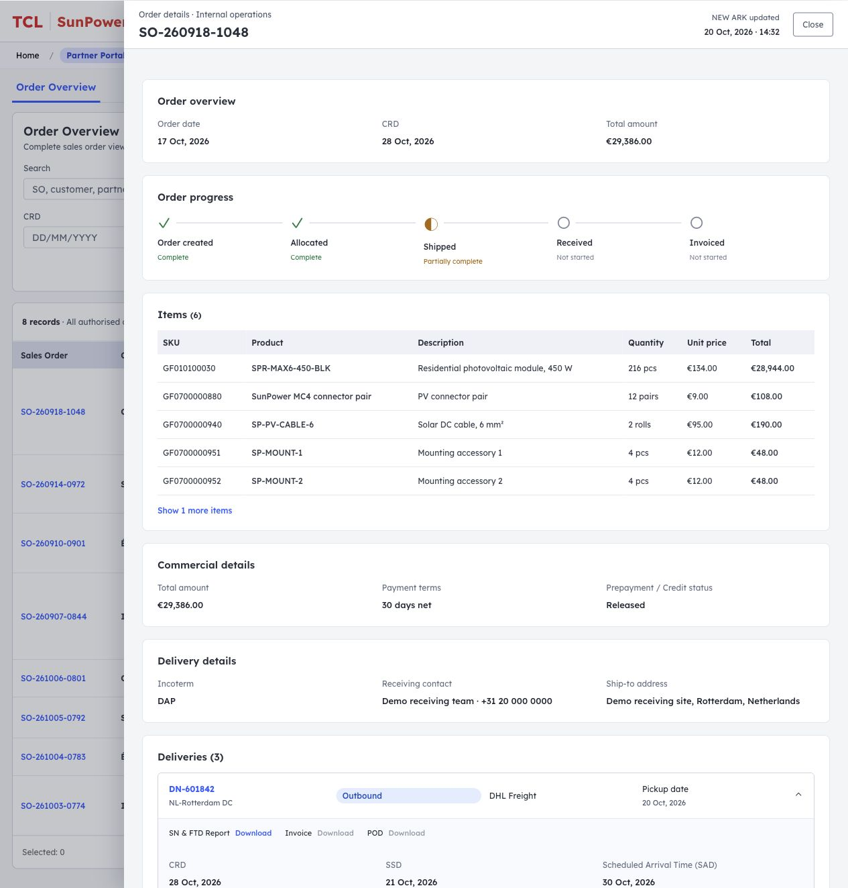
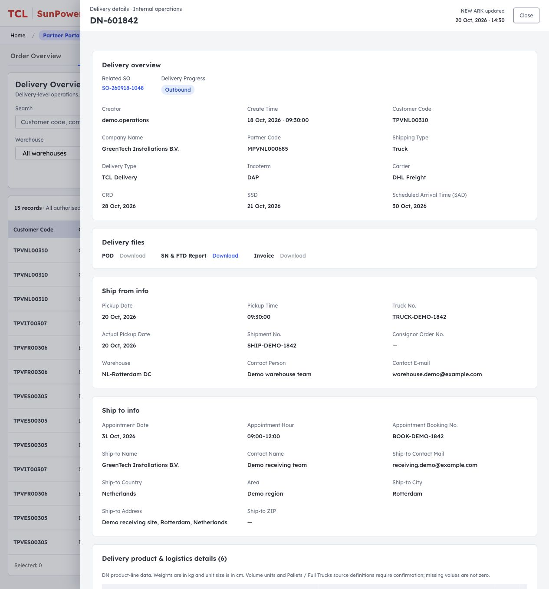
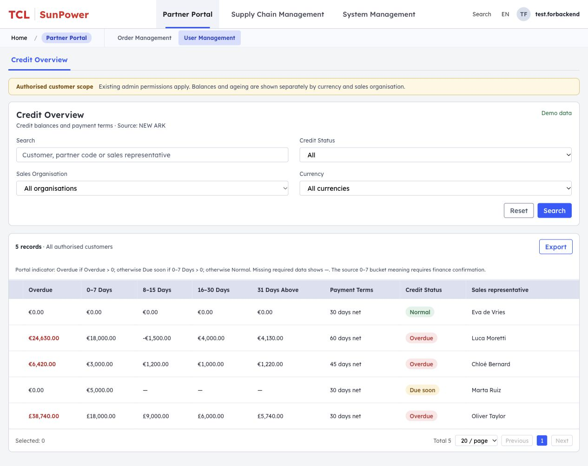

# 产品需求文档（PRD）

## 1. 文档头（元信息）

- 文档标题：SunPower Partner Portal — My Orders 与运营后台
- 版本：v1.0
- 文档状态：首版需求草案，尚未交付研发
- 作者 / 日期：待填写 · 2026-10-22
- 关联系统 / 模块：Partner Portal、新方舟（NEW ARK）订单、交付、客户及文件接口

## 2. 需求概述

### 2.1 背景与目标

合作伙伴需要自助查询历史订单、订单进度、交付和报告；业务运营需要跨客户查看完整订单、交付及信用数据。目标是覆盖授权历史订单，支持一个 SO 的全部产品和 DN，列表、详情及导出使用一致的查询口径。

### 2.2 分期边界

本期为下单可视化二期：只读查询、筛选、详情、文件下载、导出及客户前台联系销售。业务数据维护、订单审批和信用调整仍在 NEW ARK 完成。

## 3. 名词术语表

| 术语 | 说明 |
| --- | --- |
| SO | Sales Order，销售订单 |
| DN | Delivery Number，交付编号；一个 SO 可关联多个 DN |
| CRD | Customer Requested Date，客户期望日期 |
| SSD | NEW ARK 日期字段，业务全称及口径待确认 |
| SAD | Scheduled Arrival Time，预计到货日期 |
| POD | Proof of Delivery，签收证明 |
| SN & FTD Report | 当前 DN 的序列号与测试结果统一报告入口 |
| Customer Code / Partner Code | 下游客户主体编码 / Portal 合作伙伴编码 |
| Order Progress / Delivery Progress | SO 整单映射进度 / DN 源业务进度 |
| Partial | 当前阶段部分完成标记 |
| Credit Status | Portal 根据财务金额计算的展示标签 |

## 4. 用户 / 角色定义

| 角色 | 权限范围 | 说明 |
| --- | --- | --- |
| Portal 客户用户 | 所属授权客户的订单、DN、文件及导出 | 客户范围由账号关联关系确定 |
| Portal 前台 Admin / 信用授权 Role | 以上权限及前台 Credit overview | 默认仅 Admin；其他 Role 名称及权限标识待确认 |
| 后台业务运营 | 既有菜单、功能权限及客户范围内的查询、下载、导出 | 可跨客户，不套用前台 Admin / 特定 Role 条件 |
| 销售代表 | 接收客户邮件咨询 | 邮件由客户邮件客户端发送 |

所有数据和下载接口均由服务端校验客户范围、对象归属和功能权限。

## 5. 需求范围（功能清单 + 优先级 + 分期）

| 序号 | 系统模块 | 功能描述 | 优先级 | 期数 | 主责人 |
| --- | --- | --- | --- | --- | --- |
| 1 | Portal / My Orders | 信用概览、订单查询与五阶段进度 | P0 | 二期 | 待填写 |
| 2 | Portal / 详情 | 产品、商业信息、多个 DN 与报告下载 | P0 | 二期 | 待填写 |
| 3 | Portal / 操作 | 联系销售、当前查询结果导出 | P1 | 二期 | 待填写 |
| 4 | 后台 / Order Management | Order Overview、Delivery Overview 及独立详情 | P0 | 二期 | 待填写 |
| 5 | 后台 / User Management | Credit Overview 及信用标签计算 | P0 | 二期 | 待填写 |
| 6 | 后台 / 查询操作 | 组合筛选、Reset、分页及导出 | P1 | 二期 | 待填写 |
| 7 | NEW ARK 对接 | 客户编码映射、实时查询及按需文件请求 | P0 | 二期 | 待填写 |

## 6. 整体流程图

Portal 所有业务数据统一通过 NEW ARK 实时获取，底层系统整合由 NEW ARK 负责。

~~~mermaid
flowchart TD
    A["进入 My Orders"] --> B["以 Partner Code 查询 NEW ARK 客户映射"]
    B --> C["取得授权 Customer Code 范围"]
    C --> D["实时查询历史订单"]
    C --> E["有权限时查询信用及账期"]
    D --> F["点击 SO：查询订单明细和关联 DN"]
    F --> G["点击 DN 文件：请求独立文件接口"]
    C --> H["后台按菜单和客户范围查询 SO / DN / Credit"]
    H --> I["点击 DN：查询独立交付详情"]
~~~

| 触发时机 | 请求内容 |
| --- | --- |
| 进入页面、提交筛选、切换分页 | 当前授权范围及条件下的最新数据 |
| 打开 SO / DN 详情 | 当前对象明细及关联数据 |
| 导出 | 全部匹配记录 |
| 点击下载 | 当前 DN 文件及最新下载授权 |

订单准入条件为 NEW ARK **Approve Status = Approved**。该条件适用于前后台列表、详情、关联 DN、统计、导出及文件校验。审批中、其他值、空值和未知值均排除。

Partner Code 先换取 Customer Code，再发起业务查询；一对多映射按授权范围处理。

## 7. 需求详细说明（每个功能一个章节）

### 7.1 功能说明

#### 7.1.1 菜单与页面入口

前台 Products 与 My Orders 为顶部同级菜单，当前浏览器标签页切换。My Orders 保留 Back to products。订单号或 View details 打开详情抽屉，关闭后保留列表条件和位置。

后台菜单：

- Partner Portal → Order Management → Order Overview / Delivery Overview
- Partner Portal → User Management → Credit Overview

#### 7.1.2 页面功能明细

| 页面区域 | 功能 |
| --- | --- |
| 前台信用概览 | 按权限展示 Credit limit、Available amount、Overdue、Payment terms |
| 前台筛选 | 搜索 SO / SKU / 产品型号，Order Progress，Order date range |
| 日期组件 | 单击展开区间组件；From / To，DD/MM/YYYY，Apply / Cancel |
| 前台订单详情 | Order overview、Order progress、Items、Commercial details、Delivery details、Deliveries |
| 后台查询 | 各 Overview 的组合筛选、详情与导出 |

前台列表：

日期区间：

前台订单详情：

#### 7.1.3 前台订单列表

按下表顺序展示。默认按 Order date 倒序。

| 字段 | 格式 / 交互 | 空值 |
| --- | --- | --- |
| Order No. | SO 编号，点击打开详情 | 必填 |
| Products | 展示前两项，其余显示 +N more product | — |
| Total amount | 金额符号及两位小数，例如 €8,000.00 | — |
| Order date | D MMM, YYYY，例如 17 Oct, 2026 | — |
| Scheduled arrival time | D MMM, YYYY，例如 17 Oct, 2026 | To be confirmed |
| Order Progress | 第 7.2 节映射结果 | — |
| Action | View details | — |

前台日期格式同时适用于详情及导出；金额统一采用上表格式。

Order Progress 筛选为 All order progress (incl. partial)、Order created、Allocated (incl. Partially Allocated)、Shipped (incl. Partially Shipped)、Received、Invoiced (incl. Partially Invoiced)。选择阶段时包含该阶段的完整与部分状态，All 包含全部状态。

#### 7.1.4 前台订单详情

| 区域 | 内容 / 交互 |
| --- | --- |
| 顶部 | SO 编号、Close、信封图标 + Contact your sales representative |
| Order overview | Order date、Scheduled Arrival Time |
| Order progress | 第 7.2 节五节点 |
| Items | SKU、Product、Description、Quantity、Unit price、Total；默认 5 条，可展开全部并收起 |
| Commercial details | Total amount、Payment terms、Prepayment / Credit status |
| Delivery details | Scheduled Arrival Time、Incoterm、Receiving contact、Ship-to address |

联系销售使用 mailto 唤起邮件客户端，主题带入订单号。销售邮箱缺失时提示不可用。

#### 7.1.5 前台 Deliveries

仅展示已发货 DN；没有已发货 DN 时隐藏 Delivery details 和 Deliveries。

- 每个 DN 卡片展示 DN、Warehouse、Status、Carrier、Pickup date，可展开和收起。
- 展开区产品列为 SKU、Product、Description、Quantity，数量取当前 DN 实际交付数量。
- 每个卡片外层各有一个带下载图标的 SN & FTD Report、Invoice 入口，收起仍可见。
- 文件归属 DN，点击文件与展开卡片是独立操作；可用性见第 7.1.10 节。

#### 7.1.6 后台 Order Overview

筛选：关键词（SO、Company Name、Customer Code、Partner Code、SKU、DN）、Order Progress、Country、CRD 区间、Scheduled Arrival Time (SAD) 区间、Sales Organisation。

后台进度选项为 All、Order created、Partially Allocated、Allocated、Partially Shipped、Shipped、Received、Partially Invoiced、Invoiced，精确匹配。

列表字段及顺序：

| 分组 | 字段 |
| --- | --- |
| 身份 | Sales Order、Company Name、Customer Code、Partner Code、Market |
| 日期与进度 | Order Date、CRD、Scheduled Arrival Time (SAD)、Order Progress |
| 业务 | Products、Ordered / Allocated / Shipped、Delivery Number、Total Amount、Credit、Sales Rep.、Updated |
| 操作 | Operation：View |

- SAD 按关联 DN 逐条展示“日期 + DN”；同日仍保留各 DN，缺失日期为 To be confirmed。SAD 区间命中任一 DN 即返回 SO，并保留全部关联日期。
- Products 前两项分行展示，超过两项显示 Show more；点击打开当前 SO 详情并定位、展开全部 Items。
- Delivery Number 显示首个 DN 和 +N，点击查看全部关联编号，再定位对应 DN。
- 订单详情保留前台产品、商业和收货信息，增加客户及运营信息，具体内容如下。

| 详情区域 | 字段 / 内容 |
| --- | --- |
| 抽屉顶部 | SO 编号、右上角 NEW ARK updated、Close |
| Order overview | Order date、CRD、Total amount |
| Order progress / Items / Commercial details | 与前台相同 |
| Delivery details | Incoterm、Receiving contact、Ship-to address |
| Deliveries | 全部真实关联 DN（含未发货）；卡片、产品及文件；各 DN 的 CRD、SSD、SAD |
| Customer & operational information | Company name、Customer code、Partner code、Market、Sales organisation、Sales representative、Ordered / Allocated / Shipped、Remark for customer |

#### 7.1.7 后台 Delivery Overview

筛选：关键词（Customer Code、Company Name、Partner Code、SO、DN）、Delivery Progress、Warehouse、Pickup date 区间。

列表每个 DN 一行，列顺序：Customer Code、Company Name、Partner Code、SO、DN、Delivery Progress、Warehouse、Carrier、Pickup Date、CRD、SSD、Scheduled Arrival Time (SAD)、POD、SN & FTD、Invoice。

SO 打开订单详情；DN 打开独立交付详情，仅展示当前 DN 及其产品：

| 详情区域 | 字段 |
| --- | --- |
| 顶部 | DN、右上角 NEW ARK updated、Close |
| Delivery overview | SO、Delivery Progress、Creator、Create Time、Customer Code、Company Name、Partner Code、Shipping Type、Delivery Type、Incoterm、Carrier、CRD、SSD、SAD |
| Ship from | Pickup Date、Pickup Time、Truck No.、Actual Pickup Date、Shipment No.、Consignor Order No.、Warehouse、Contact Person、Contact E-mail |
| Ship to | Appointment Date、Appointment Hour、Appointment Booking No.、Ship-to Name、Contact Name、Ship-to Contact Mail、Ship-to Country、Area、Ship-to City、Ship-to Address、Ship-to ZIP |
| 产品物流表 | DN Item No.、SKU、Product、Material Description、Quantity、Unit、Unit Size (cm)、G.W.U. (kg)、N.W.U. (kg)、Total G.W. (kg)、Total N.W. (kg)、Volume、Total Volume、Customs Tariff、Customs Description、Pallets、Full Trucks |
| 文件 | 当前 DN 的 POD、SN & FTD、Invoice |

Creator / Create Time 取 DN 创建信息。产品行只取该 DN 明细。尺寸、重量及体积按接口单位展示；Pallets、Full Trucks 的单位和业务含义待确认。

#### 7.1.8 后台 Credit Overview

筛选：关键词（Customer Code、Company Name、Partner Code、Sales representative）、Credit Status、Sales Organisation、Currency。

列表及导出字段顺序：

Customer Code、Company Name、Partner Code、Sales Organisation、Currency、Credit Limit、Available Amount、Overdue、0–7 Days、8–15 Days、16–30 Days、31 Days Above、Payment Terms、Credit Status、Sales representative。

同一客户按币种、销售组织分别展示，保留源金额负值、0 和缺失值。Overdue 使用 NEW ARK 返回值。

Credit Status 为 Portal 计算标签，按下表自上而下判断，筛选、计数和导出共用此规则：

| 条件 | Credit Status |
| --- | --- |
| Overdue 为有效数值且 > 0 | Overdue |
| Overdue 为有效数值且 ≤ 0，0–7 Days 为有效数值且 > 0 | Due soon |
| 上述两项均为有效数值且 ≤ 0 | Normal |
| 缺少判断所必需的值，或值无效 | — |

“0–7 Days = 未来 7 天到期金额”的语义须经财务确认后启用 Due soon；如源字段实际为已逾期账龄，应改用 NEW ARK 提供的未来到期字段。

#### 7.1.9 后台布局与交互

- 桌面详情信息区每行三列，窄屏自适应两列 / 一列，长文本换行。
- 表格横向滚动时 Order 的 Operation 固定在右侧；Delivery 的 POD、SN & FTD、Invoice 三列整体固定。固定区域左侧使用柔和阴影。
- 文件操作采用与 View 一致的蓝色文字 Download；不可用时为灰色禁用 Download。
- 信用表以 Sales representative 为最后一个普通数据列。
- 筛选区提供 Reset、Search；结果工具栏提供 Export。
- 控件采用英文，筛选边框浅灰，聚焦蓝色；后台延续现有 Admin 样式。

#### 7.1.10 DN 文件下载

| 文件 | 最低业务条件 | 使用页面 |
| --- | --- | --- |
| SN & FTD Report | 当前 DN 已 Shipped | 前台 / 后台 |
| Invoice | 当前 DN 已 Received | 前台 / 后台 |
| POD | NEW ARK 返回当前 DN 的签收证明可用状态 | 后台 |

可下载须同时满足业务节点、文件就绪及下载权限。NEW ARK 文件接口按 DN 独立校验并返回文件或受控下载地址。

禁用入口支持 hover / 键盘聚焦提示：

| 原因 | 英文提示 |
| --- | --- |
| 未到节点 | The required milestone has not been reached yet. |
| 已到节点但文件未就绪 | The file is not available yet. Please try again later. |
| 无下载权限 | You do not have permission to download this file. |

#### 7.1.11 Export

导出当前条件下的**全部授权匹配数据**，覆盖全部分页，使用 UTF-8 CSV。字段顺序及粒度如下：

| 页面 | 粒度 | 导出字段 |
| --- | --- | --- |
| 前台 My Orders | 每 SO 一行 | Order No.、Products、Total amount、Order date、Scheduled arrival time、Order Progress |
| 后台 Order Overview | 每 SO 一行 | 第 7.1.6 节列表业务字段，Sales Order 导出名为 SO |
| 后台 Delivery Overview | 每 DN × 产品行一行 | 下列交付字段顺序 |
| 后台 Credit Overview | 每客户 × 币种 × 销售组织一行 | 第 7.1.8 节全部字段 |

Products 导出全部产品名称及 SKU；DN 与 SAD 保留一一对应关系。文件导出可用状态，操作控件不作为数据列。

Delivery 导出字段按以下各组顺序拼接：

1. Customer Code、Company Name、Partner Code、SO、DN、Delivery Progress、Warehouse、Carrier、Pickup Date、CRD、SSD、Scheduled Arrival Time (SAD)。
2. Creator、Create Time、Shipping Type、Delivery Type、Incoterm、Pickup Time、Truck No.、Actual Pickup Date、Shipment No.、Consignor Order No.、Warehouse Contact Person、Warehouse Contact E-mail。
3. Appointment Date、Appointment Hour、Appointment Booking No.、Ship-to Name、Receiving Contact Name、Ship-to Contact Mail、Ship-to Country、Ship-to Area、Ship-to City、Ship-to Address、Ship-to ZIP、NEW ARK Updated。
4. 第 7.1.7 节产品物流表全部字段，保持该表顺序。
5. POD Available、SN & FTD Available、Invoice Available。

DN 无产品行仍保留一条头记录；头字段在各产品行重复。缺失值导出为空，源数值和单位保持不变。

### 7.2 状态流转与 Order Progress 计算

#### 7.2.1 输入字段与粒度

以下使用 NEW ARK 导出列名，接口字段编码由对接方提供。

| 输入字段 | 粒度 / 用途 |
| --- | --- |
| SO No. | 整单标识；合并同一 SO 的导出行 |
| Order status | 整单业务汇总状态，决定整单进度阶段 |
| SO Line | 订单行标识；关联 DN 展开产生的重复行按 SO No. + SO Line 去重 |
| Status | SO 明细行业务状态，用于明细 / 节点核对 |
| Allocation Status | SO 明细行分配状态，用于汇总订单分配完成度 |
| Approve Status | 查询准入校验，见第 6 节 |
| System Status | 系统处理状态，仅用于受控排查 |

**Order status 与 Status 是两个字段。Portal 列表取整单 Order status，不取第一条明细行 Status。** 同一 SO 的 Order status 应一致；冲突时进度返回未知并记录异常。

#### 7.2.2 分配完成度

对完整 SO 的有效订单行（至少一条），按 SO No. + SO Line 去重后读取 Allocation Status。同一行重复记录的分配状态冲突时，完成度为 Unknown。

| 所有订单行的 Allocation Status | 分配完成度 |
| --- | --- |
| 全部为 Allocated | Complete |
| 全部为 To Be Allocated | Not started |
| 值均在 Allocated / Partially Allocated / To Be Allocated 中，且存在 Partially Allocated，或 Allocated 与 To Be Allocated 混合 | Partial |
| 存在缺失、未知值，或未取得完整行集 | Unknown |

以上为本期建议汇总口径，需 NEW ARK 确认订单行范围及枚举；取消 / 退货行范围待确认。若接口直接返回整单分配状态，可经口径核对后使用该值。

#### 7.2.3 整单映射及判定优先级

先完成准入校验，再按下表自上而下匹配。晚期整单业务状态直接映射；只有创建 / 运输准备阶段使用分配完成度。

| 优先级 | Order status 的值 | 其他条件 | Portal 列表展示 |
| --- | --- | --- | --- |
| 1 | Invoiced | — | Invoiced |
| 2 | Partially Invoiced | — | Invoiced · Partial |
| 3 | Customer Signed | NEW ARK 已确认其含义为客户收货 / POD | Received |
| 4 | Shipped | — | Shipped |
| 5 | Partially Shipped | — | Shipped · Partial |
| 6 | Partially Prepare Truck / Partially Truck TBC | — | Allocated · Partial |
| 7 | Created / Prepare Truck / Truck TBC | 分配完成度 = Complete | Allocated |
| 8 | Created / Prepare Truck / Truck TBC | 分配完成度 = Partial | Allocated · Partial |
| 9 | Created | 分配完成度 = Not started | Order created |
| 10 | 其他值 / 空值 / 无法满足上述条件 | — | — |

Prepare Truck / Truck TBC 配合 Not started 或 Unknown 属于待核对组合；Customer Signed 的签收语义未确认时返回未知。

计算示例：

| 输入 | 输出 |
| --- | --- |
| Approved；Order status = Created；全部行 To Be Allocated | Order created |
| Approved；Order status = Created；行分配状态为 Allocated + To Be Allocated | Allocated · Partial |
| Approved；Order status = Prepare Truck；全部行 Allocated | Allocated |
| Approved；Order status = Partially Shipped；部分行仍 Created | Shipped · Partial |
| Approved；Order status = Partially Invoiced；部分行 Invoiced、部分行 Shipped | Invoiced · Partial |
| Approved；Order status = Invoiced；System Status = SAP Sync Failed | Invoiced |
| Approving；Order status = Created | 排除该订单 |

因此 System Status、单个 DN 状态、文件存在与否均不改变整单映射结果。建议由 Portal 服务端统一输出 stage、completion（完整 / 部分 / 未知）及展示文案，列表、筛选、导出共用。

#### 7.2.4 详情节点与筛选

五节点为 Order created → Allocated → Shipped → Received → Invoiced。业务事件在 NEW ARK 发生，Portal 查询时更新结果。

- Order created：有效 SO 创建完成。
- Allocated：按第 7.2.2 节展示分配完成度。
- Shipped、Received、Invoiced：分别使用 NEW ARK 提供的整单对应节点完成度；多行、多 DN 场景下，每个节点独立支持未开始、部分完成、已完成、未知。
- 列表 stage 不能证明之前所有节点全部完成。开票和收货顺序以实际业务事件为准；节点缺少依据时显示未知。
- 三个节点的准确源字段、数量范围及部分 / 全部完成口径须由 NEW ARK 提供并确认，不能仅用当前 Order status 反推整条进度条。
- 前台按阶段包含 Partial，后台按独立状态精确筛选，展示文案均使用第 7.2.3 节结果。
- Delivery Progress 使用 NEW ARK 的 DN 业务状态，独立于 SO 五节点。

### 7.3 异常 / 边界场景

| 场景 | 处理 |
| --- | --- |
| 无结果 | No orders found；保留查询条件 |
| 编码映射缺失 / 归属无权限 | 提示关联异常或拒绝访问 |
| 日期无效 / From 晚于 To | 阻止 Apply，提示 Use DD/MM/YYYY. / From date must be earlier than To date. |
| 查询失败 | 失败区域单独提示 Retry，其他成功区域正常展示 |
| DN 查询失败 | 展示失败，不作为“无 DN”处理 |
| Carrier 未分配 | Pending assignment |
| 文件请求失败 / 重复点击 | 提示失败并可重试；请求期间防重复触发 |
| 金额、日期、物流字段缺失 | 展示 —，SAD 使用 To be confirmed；真实 0 单独保留 |
| CRD / SSD / SAD / Pickup Date 不同 | 各字段按自身来源展示 |
| 超长文本 / 多产品、多 DN | 换行或展开查看完整内容 |

## 8. 非功能需求

- 服务端分页；列表及详情性能目标为正常负载下 p95 ≤ 2 秒，导出大数据量走后端任务，阈值待确定。
- 查询、导出、下载进行权限隔离测试；日志记录对象 ID、结果及错误码，下载地址受控。
- CSV 正确转义逗号、引号和换行，处理公式注入风险。
- 支持主流桌面浏览器、键盘操作、抽屉焦点管理和英文日期组件。

## 9. 埋点 / 数据需求

| 事件 | 记录内容 |
| --- | --- |
| 列表查询 | 页面、条件类型、结果数、耗时、成功 / 失败 |
| 查看详情 | SO / DN 标识、入口、结果 |
| 导出 | 页面、条件摘要、行数、结果 |
| 文件下载 | DN、文件类型、结果、失败原因 |
| 联系销售 | SO、入口点击 |

## 10. 历史数据处理

查询全部授权可用历史数据，由 NEW ARK 提供归档边界和分页能力。历史文件缺失按文件未就绪处理。

## 11. 跨系统对接说明

| NEW ARK 接口能力 | 请求依据 | 主要返回内容 |
| --- | --- | --- |
| 客户映射 | 登录身份、Partner Code | 授权 Customer Code、组织关系 |
| 订单列表 / 明细 | Customer Code 范围、条件 / SO | 整单状态、订单行、产品、商业和运营字段 |
| 交付列表 / 明细 | Customer Code 范围、条件 / DN | 交付头、DN 产品物流行、各 DN 源更新时间 |
| 客户信用及账期 | Customer Code、币种、销售组织 | 额度、Overdue、账龄、Payment Terms、Sales representative |
| 文件可用性 / 下载 | DN、文件类型及文件标识 | 可用状态、原因、文件或受控地址 |

接口需提供稳定唯一键、真实总数、源业务更新时间、日期时区及数值单位。NEW ARK updated 为源记录更新时间。订单、交付和信用请求分别返回，可局部失败。

## 12. 依赖与风险

待对接确认：

1. Partner Code → Customer Code 一对多映射、有效期及后台客户范围权限；前台信用 Role。
2. NEW ARK 字段编码、Order status 的整单粒度、分配汇总有效行范围，以及三个后续节点的完成度字段。
3. Customer Signed 是否为实际收货签收；DN 签收、文件门槛的准确业务标识。
4. SSD 含义、SAD 日期时区、物流单位、Pallets / Full Trucks 口径。
5. 财务 0–7 Days 语义、销售代表与组织关系。
6. SN & FTD 合并报告、DN 文件一对多关系、下载有效期、历史覆盖及导出任务阈值。

状态语义未确认时使用未知结果；数据缺失或接口失败按第 7.3 节处理。

## 13. 附录

### 13.1 原型与资料

- [My Orders](https://nickiisme.github.io/product-list/sunpower-my-orders.html)
- [运营后台](https://nickiisme.github.io/product-list/admin-order-management/)
- [PRD](https://github.com/Nickiisme/product-list/blob/main/docs/SunPower_My_Orders_PRD.md)
- 状态字段参考：用户提供的 NEW ARK SO / DN 导出及状态透视截图。

### 13.2 验收范围

1. 按第 4、6 节验证客户范围、信用权限、Approved 准入和实时查询。
2. 按第 7.1 节逐页核对字段、顺序、筛选、详情、固定操作区及导出。
3. 按第 7.2 节验证各源值、部分状态、混合行、去重、缺失和冲突组合；未确认语义有明确阻断项。
4. 按第 7.1.10 节逐 DN 验证节点、文件就绪、权限及禁用提示。
5. 验证多产品、多 DN、多币种、负值、零和失败场景，以及全部匹配分页导出。

### 13.3 原型边界

线上 Demo 使用示例数据，未连接 NEW ARK 和真实认证权限。已演示菜单、详情、部分本地筛选、状态标签、导出及固定列；后台日期 / 仓库等完整组合查询、服务端分页和真实下载待接口接入。Demo 不代表生产数据已实时接通。
